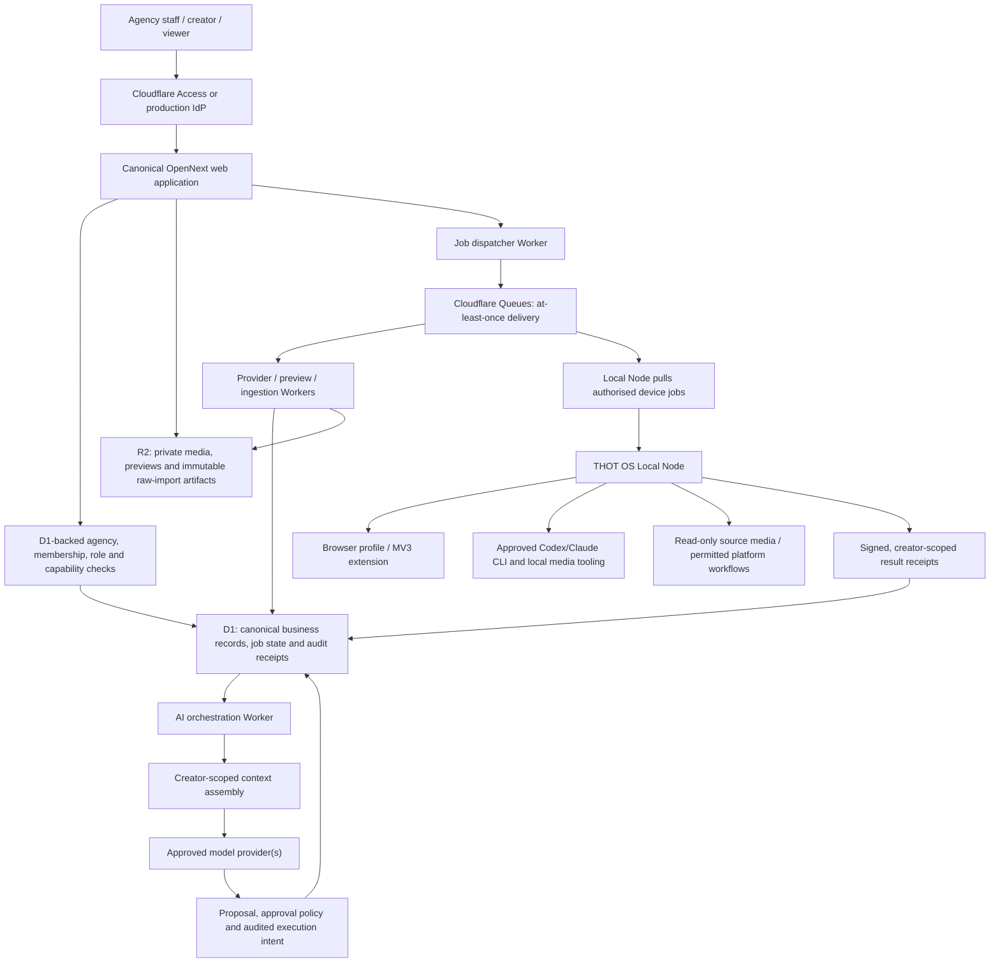

# THOT OS — Architecture Authority Decision

**Decision phase:** analyse → compare → decide → design only.

No application code, infrastructure, data, configuration, deployment, credential, queue, or migration was changed while preparing this document. This is a decision record derived from the verified audit and Phase 0 protection record, not an implementation plan that is already in effect.

## Short answer

THOT OS should become a **Cloudflare-first control plane** whose canonical web application is `cloudflare/thot-os-next` and whose canonical relational system of record is **Cloudflare D1**. It should use a deliberately narrow **THOT OS Local Node** for capabilities that truly require a controlled machine: browser/extension interaction, local media access and processing, and approved local CLI execution.

This is **Option C: an explicitly separated hybrid**, not two applications that each own product data:

- Cloudflare OpenNext/D1/R2 owns user access, tenant authorization, business records, approvals, job state, audit receipts, and remote product experience.
- The Local Node owns only device-local execution and temporary scratch state. It never becomes a second creator-data authority and does not dual-write business records to SQLite.
- Existing root Next.js/SQLite functionality is neither disposable nor the target product application. Each root-only capability must be ported, retained as a Local Node capability, retired, or redesigned before the root application can be called legacy.

## Why this architecture

The root application has the broadest functionality and unique local operational data, but it is intentionally loopback-bound, depends on one Mac and locally installed tools, and authorizes its active creator from an unauthenticated cookie. It is not a safe canonical multi-creator platform if exposed.

The Cloud application already has the right direction: a real staging deployment, Cloudflare Access JWT verification, D1-backed active user/membership checks, creator-scoped authorization, R2 integration, and dedicated provider Workers. Its gaps are material but addressable: no production environment, a name collision with the legacy Worker, incomplete feature parity, and a broken queue pipeline. Those gaps are reasons to plan a controlled migration, not reasons to retain a single-Mac control plane.

The result is a single authority for each domain, a remote system that works when the Mac is offline, and a safe place to retain capabilities that cannot reliably run in Workers.

## Recommended target architecture



### Non-negotiable ownership rule

A Queue, Worker cache, Local Node spool, browser extension, model provider, or R2 object is **not** an alternative authority for a business record. D1 holds the authoritative record and state transition; R2 holds the authoritative bytes for Cloud-managed objects. All asynchronous executors return an idempotent receipt to D1.

## 1. Direct comparison of the current applications

| Capability | Root Next.js / SQLite | Cloudflare OpenNext / D1 | Preferred authority | Migration required |
|---|---|---|---|---|
| Creator management | Broad local UI/actions and three active local creators | Creator/admin pages and D1 `creators` | Cloud application + D1 | Reconcile creator IDs/slugs and retain local-only attributes. |
| User identity | No root user authentication | Access JWT plus active D1 `users` | Cloud application + D1 | Introduce explicit agency/platform hierarchy before broader access. |
| Memberships / permissions | Active-creator cookie is treated as authority | D1 memberships and server-side permission checks | Cloud application + D1 | Port only needed root workflows behind canonical authorization. |
| Content assets | Local SQLite registry of 1,012 assets pointing to Dropbox source | D1 registry of 403 assets, R2 preview/media references | D1 metadata; R2 Cloud-managed bytes | Creator-scoped inventory reconciliation and source-location mapping. |
| Classification / consent / suitability | Implemented locally | D1 tables and tested Cloud flows | D1 | Merge root classifications and audit histories after conflict review. |
| Operational accounts | Root `accounts` and connections | D1 `operational_accounts`, provider connections and device profiles | D1 | Transform fields and require human review of duplicate/old accounts. |
| Publishing | Root post packages, jobs, receipts and local adapters | D1 social-post model plus Reddit/Instagram/Vault Workers | D1 intent/receipt; Cloud or Local Node executor | Map root package/job records and preserve receipts; reauthorize providers. |
| Scheduling | In-process root scheduler starts with Next instrumentation | Scheduled Workers exist but outcomes are unverified | D1 job state + Cloud dispatcher | Retire the process-owned scheduler only after durable jobs are proven. |
| Messages / engagement | Local bridge, message threads, drafts and receipts | D1 messages/threads and platform-specific Cloud paths | D1 | Match by creator, provider connection and external message ID; resolve time-line conflicts. |
| Creator relationships | People/tags tied to assets; no complete relationship domain | People/asset links, no complete creator-relationship domain | New D1 relationship domain | Design before porting local notes; no current automatic mapping. |
| Creator memory / voice / research | Local voice profiles, research findings, agent tasks | No complete Cloud memory service | New D1 memory model | Port structured profiles/research selectively; redesign task context. |
| AI tasks | Codex/Claude CLI runner, local SQLite status records | No deployed model gateway or agent service | Cloud orchestration + Local Node executor initially | Reuse safe task isolation but move authority, policy, receipts and budgets to D1. |
| Browser bridge | MV3 extension and loopback local bridge | Browser/device pairing models and Vault Bridge | Local Node + D1 device registry | Replace root bearer pairing and local DB authority with Cloud-controlled device jobs. |
| Analytics | Local CSV/import, Instagram metrics | D1 metrics/snapshots and Cloud WIP | D1 facts; R2 raw imports | Normalize dates/currencies and deduplicate imports per creator/provider period. |
| Finance | Local financial settings/reporting | D1 finance imports, daily metrics and audit tables | D1 | Import only normalized, reviewable historical facts. |
| Previews / vault | Local source access and vault queue | R2 private previews, D1 preview/vault job models, Vault Bridge | D1 + R2; Local Node if source access is required | Reconcile asset keys; preserve device-bound bridge behavior. |
| Integrations / credentials | Local OAuth/Composio ciphertext and app-local secrets | Provider connection, service credential, grant and browser-profile tables | D1 metadata; Worker/local secret stores | Do not copy active provider tokens blindly; reauthorization is the default. |
| Audit logs / receipts | Local workflow, messaging and publication receipts | D1 identity, finance, social and messaging audits | D1 | Preserve historical root receipts with source provenance. |
| Automation | Local in-process scheduler and gateway client | Queues exist but intake/AI consumers are absent | D1 job state + redesigned Queues | Replace the callback-dependent gateway architecture. |
| Agency admin | Root operator UI | D1 membership-derived agency-admin UI/tests | Cloud application + D1 | Add agency boundary and platform-level administration explicitly. |
| Super-admin | No coherent model | No separate verified super-admin model | New D1 platform-admin model | Design explicit break-glass capability; do not overload agency admin. |

### Root capabilities that must not be discarded

The root application currently contains unique local data and valuable operational behavior: Dropbox catalogue/source awareness, local media paths, browser extension flows, local bridge workflows, Codex/Claude CLI isolation, message and publication receipts, voice/research context, analytics imports, and broader reporting. It is a migration source and an execution-capability source, not abandoned code. Each item appears in the feature plan below.

## 2. Application and database authority

### Canonical application

**Recommendation:** `cloudflare/thot-os-next` becomes the canonical THOT OS web/control-plane application.

It is the only current application with a deployed remote target and a proven authorization pattern in which an authenticated identity is intersected with an active D1 membership. The root app must remain loopback-only during transition and must never be exposed as a parallel creator portal.

`cloudflare/thot-os-app` does not become a second application. It is a legacy Worker foundation and current migration location that shares `name: "thot-os-staging"` with the OpenNext app. It must be treated as deployment-frozen until a later approved ownership/name decision.

### Authoritative datastore

**Recommendation:** D1 is the authoritative relational store for all platform business data, one explicitly named database per environment. R2 is authoritative only for Cloud-managed binary objects and raw-import artifacts; it is not a relational business-data store.

D1 is the right current authority because it is remote, already backs the Cloud authorization model, integrates with Workers/R2/Queues, has a reviewed migration history, and is the active staging database. The present size and workload do not justify a new database platform solely to avoid a migration decision.

This does not mean D1 makes tenant isolation automatic. D1 has no RLS. The target must centralize creator-scoped repository access, use mandatory tenant predicates and foreign keys, make `creator_id` non-null for creator-owned data, and exercise cross-creator isolation tests on every mutation path. A missed predicate remains a platform-wide risk until those controls exist.

### SQLite future

SQLite has a precise transitional role:

1. **Migration source and protected archive** for unique historical/local data.
2. **Sanitized local-development fixture** when needed; never a default connection to staging or production.
3. **No live control-plane ownership and no synchronization peer** after a domain has cut over.
4. **Optional Local Node scratch/spool only**, with encrypted, expiring job material that is not a duplicate business database.

SQLite cannot be retired until every retained root domain has been migrated or deliberately retained locally, data retention requirements are met, provider/device reauthorization is complete, and rollback no longer needs it.

## 3. Domain authority matrix

Every target domain has exactly one owner. “Merge” describes the controlled migration input, not future dual ownership.

| Domain | Current authorities | Future authority | Migration direction / target rule |
|---|---|---|---|
| Platform / agency identity | No complete agency model; D1 users/memberships | D1 | Add explicit agency/platform hierarchy; migrate valid users/memberships into D1 only. |
| Creator profile and status | SQLite + D1 | D1 | Reconcile by stable creator ID/slug; D1 becomes the sole writable record after cutover. |
| Creator memberships / roles | Root selector + D1 memberships | D1 | Root selector becomes preference only; every grant is D1-backed. |
| Creator relationships / people | SQLite and D1 people/asset links | D1 | Design a relationship model first; migrate only source-attributed, creator-scoped facts. |
| Assets and metadata | SQLite + D1 | D1 | Inventory both stores; merge by creator plus stable source identity/revision, never by filename alone. |
| Original source and media bytes | Local Dropbox paths; partial R2 | D1 source registry plus R2 for accepted Cloud copies | D1 records source/location; R2 owns Cloud-managed objects; Dropbox remains a read-only ingest source until explicitly copied. |
| Previews and derived media | Local files + R2 | R2 with D1 job/status records | Regenerate or copy only after asset reconciliation; object keys are implementation detail, not identity. |
| Classification, tags, suitability and consent | SQLite + D1 | D1 | Merge with creator scope and provenance; preserve conflicting classifications for review. |
| Operational/social accounts | SQLite accounts/connections + D1 operational accounts | D1 | Transform to one D1 account model; require review for normalized-handle duplicates. |
| Provider credentials | Root encrypted records/local env + Cloud worker secrets | D1 metadata and grants; secure Worker/local secret storage | Reauthorize instead of bulk token migration; no credential value is a data-migration payload. |
| Content plans, posts, approvals and receipts | SQLite packages/jobs + D1 social posts/events | D1 | Map source-local IDs and idempotency/receipt data; preserve historical proof with provenance. |
| Scheduling and job state | Root process tables + partial D1 scheduler/job tables | D1 | D1 holds desired state, approval, lease and receipt; Queues carry delivery only. |
| Messages, drafts and attachments | SQLite + D1 | D1; R2 for retained attachment bytes | Deduplicate with creator/provider/external IDs; preserve unresolved conflicts rather than overwrite. |
| AI task records and proposals | SQLite agent tasks | D1 | Import selected history after privacy review; new tasks have immutable context manifests and receipts. |
| Creator memory / voice / research | SQLite | D1 | Port structured profile/research records; redesign free-form memory and summaries. |
| Analytics and finance facts | SQLite + D1 | D1; R2 for original imports | Normalize currency/date/source identifiers and import with dedupe/audit keys. |
| Audit events | SQLite + D1 | D1 | Append imported historical events with `source_system` and immutable source keys. |
| Browser / Local Node device registry | Root local bridge + D1 browser/device records | D1 | Pair devices against Cloud authority; local secrets stay on device only. |
| Automation transports | Local process + gateway + Queues | Queues / Workers, with D1 state | Drain/archival plan before disabling old producers; no transport is an authority. |
| Configuration and deployment provenance | Mac state and receipts | Versioned source + D1 deployment receipts / CI artifacts | Each deployment records Git SHA, config/environment, migration state and smoke result. |

## 4. Data migration assessment and plan

### What the evidence says

The two databases are not replicas. The protected local SQLite has 55 tables and, at capture, 3 creators, 1,012 assets, 15 accounts, 281 messages and 53 threads. Staging D1 has 51 user tables and, at capture, 3 creators, 403 assets, 6 operational accounts, 328 messages and 46 threads. They use different migration histories and overlapping but non-isomorphic models.

Therefore there must be no “SQLite wins” or “D1 wins” bulk import. D1 is the target authority, but migration is a **domain-by-domain reconciliation** from protected SQLite and active D1 into a reviewable target dataset.

### Data classification

| Class | Examples | Treatment |
|---|---|---|
| Directly mappable after identity validation | creator display metadata, asset basic metadata, classification/consent records, financial settings | Map through a documented source-to-target contract; preserve source IDs and timestamps. |
| Transform required | `accounts` → `operational_accounts`; post packages/publication jobs → social posts/events; local connections → provider/device connection models | Use explicit field mapping, enum translation, creator validation, and migration receipts. |
| Merge / deduplicate required | assets, accounts, messages, threads, posts, analytics imports | Match only on stable creator-scoped external/source identifiers; emit conflicts rather than auto-resolve ambiguity. |
| Historical records worth preserving | verified publication, workflow and messaging receipts; classification history; research with source/observation/expiry; finance imports | Preserve append-only provenance, even when not active operational state. |
| Archive rather than import by default | raw ignored deployment receipts/backups, temporary job output, obsolete zero-byte DB file, local CLI scratch | Retain in protected archive; link a summary/provenance record only where operationally useful. |
| Never automatically migrate | OAuth refresh tokens, browser sessions, extension bearer credentials, local environment secrets | Reauthorize/re-pair with the new authority. |

### High-risk conflicts requiring explicit policy

- **Assets:** the local catalogue is larger than D1. Match within a creator by durable source path and source revision where available, not basename. An unmatched local asset is a candidate, not automatically a new Cloud asset.
- **Accounts:** root has more account records than D1. Normalize platform/handle, retain original IDs, and require an operator decision for collisions or inactive records.
- **Messages:** D1 has more messages while SQLite has more threads. Use creator ID plus provider connection and external message/thread ID. Preserve both candidates where timestamps or bodies disagree and mark the record for review.
- **Posts/publication:** local package/job state and D1 social-post state use different models. Migrate historical receipts as events first; do not reactivate unfinished local jobs automatically.
- **Credentials:** metadata may be migrated, but token/session material must be reauthorized. This prevents stale or improperly scoped local authority from becoming Cloud authority.

### Migration design requirements

The future migration tool must be separate from normal application traffic and meet all of these constraints:

1. Read protected SQLite/D1 exports and write first to an isolated migration target, never directly to the active environment.
2. Use a mapping manifest with source system, source primary key, creator ID, target ID, decision (`create`, `update`, `skip`, `conflict`), reason, and content hash.
3. Be repeatable and idempotent by durable source keys and target-side migration ledger records.
4. Offer dry-run output with counts and per-record decisions before writes.
5. Require creator-scoped reconciliation; no job may process an unbounded multi-creator payload by default.
6. Preserve raw export checksums, migration version, operator identity, and comparison results in an auditable receipt.
7. Be reversible by importing into a new database or append-only staging tables first; never delete or overwrite the only copy of a source record.
8. Cut over one domain at a time, freeze writes to that domain at the old authority, validate, then designate D1 as sole writer.

## 5. Feature migration plan

| Root/current feature | Decision | Target / reason |
|---|---|---|
| Root creator/content/reporting UI | **PORT** | Cloud canonical web app, once equivalent creator-scoped routes and data exist. |
| Dropbox catalogue and source discovery | **RETAIN LOCAL SERVICE** | Local Node reads the designated read-only source and submits creator-scoped inventory/derivative jobs to Cloud. |
| Local media serving route | **RETIRE / REDESIGN** | Cloud UI uses authorized private R2 delivery; Local Node exposes no general remote file server. |
| Content classification, consent and suitability | **PORT** | Cloud D1 model already exists and is tested; reconcile historical local records. |
| Root post packages, approvals and publication jobs | **PORT** | D1 social-post/event/approval model is authoritative; map historical receipts and use durable jobs. |
| Root in-process Reddit scheduler | **RETIRE** | Replace only after D1-backed scheduled job/receipt flow is proven independent of a Next process. |
| Cloud Reddit/Instagram/Telegram adapters | **PORT / COMPLETE** | They become provider execution adapters, with provider-specific tests and receipts. |
| Browser extension / platform UI actions | **RETAIN LOCAL SERVICE, REDESIGN** | Operate through Local Node device identity, short-lived capabilities, explicit claims and signed receipts. |
| Local bridge bearer pairing | **REDESIGN** | Do not retain third-party URL-fragment credentials or one-year reusable bearer design. Reuse the safer device/profile-binding pattern already present in Cloud Vault Bridge. |
| Codex/Claude CLI runtime | **RETAIN LOCAL SERVICE** | Preserve its isolated temporary workspace and approval modes, but invoke through Local Node jobs with Cloud-owned task state and budgets. |
| Root voice profiles and research | **PORT** | Store structured creator profile/research records in D1 with source/observed/expiry provenance. |
| Free-form creator memory | **REDESIGN** | Create a D1-first memory/context model; do not copy arbitrary local prompt history as durable memory. |
| Root analytics imports/reporting | **PORT** | D1 finance/analytics facts and R2 raw-import archive; migrate only validated normalized records. |
| Root OAuth/Composio token storage | **REDESIGN** | Migrate connection metadata and reauthorize credentials through a centrally controlled provider-credential service. |
| Current staging gateway and callback queue flow | **REDESIGN** | Replace with a D1 job-state dispatcher and Local Node pull/receipt protocol; do not repair the stale callback flow verbatim. |
| MCP | **PLANNED LATER** | Add only after canonical authorization, audit, capability boundaries and stable API contracts exist. |

## 6. Local Node decision

**Local Node recommended: YES.**

Cloudflare should not be forced to impersonate a human browser, access a Mac-only Dropbox catalogue, or run locally installed Codex/Claude tools. Those are valid local capabilities. The current root app proves their usefulness but not their correct authority boundary.

### Target Local Node contract

| Concern | Decision |
|---|---|
| Authentication | A registered device identity authenticated to Cloud with rotating, revocable credentials; never a shared static gateway token. |
| Creator scope | Cloud grants only named creator/account capabilities per device; every job includes a server-derived creator ID and capability. |
| Job delivery | The Local Node makes outbound authenticated pull/claim requests. No public inbound port or permanent Mac tunnel is required. |
| Job claim | Cloud atomically leases a D1 job and records node/device, lease time and idempotency key before execution. |
| Capability permissions | Separate capabilities for source read, preview generation, browser profile use, provider action, CLI plan, CLI execute, and receipt upload. |
| Results | Node submits a signed receipt referencing the job, creator, account, action, result class and non-sensitive artifact references; Cloud validates it before state change. |
| Offline behavior | Unclaimed jobs remain pending; expired leases are retryable; jobs requiring active human browser interaction surface as waiting, not silently complete. |
| Retry and revocation | D1 state and Queue retries are idempotent; device revocation disables new claims and invalidates short-lived capabilities. |
| Local data | OS keychain/device-protected secrets plus expiring scratch files only. SQLite may not be a shared platform replica. |

The existing Cloud device/profile and service-grant models are useful starting evidence. The current staging gateway is not the target contract because it relies on an inbound callback to a local process, has stale remote code, has no queue consumers, and lacks its expected failure DLQ.

## 7. Job architecture

### Common job contract

Every asynchronous operation must carry a D1-backed job/intent record with `job_id`, `creator_id`, actor/service identity, action type, input references, approval state, idempotency key, retry policy, correlation ID, executor capability, and receipt. The Queue message contains only the job reference and minimal routing data.

| Job category | Primary execution | Why |
|---|---|---|
| Request validation, permission checks, create proposed action | Synchronous Worker / server action | Fast decision with canonical authorization and D1 state transition. |
| Asset inventory ingestion | Queue → Worker or Local Node | Eventual, bursty, creator-scoped and idempotent; Local Node is used only if source media is local/Dropbox-bound. |
| Preview generation | Queue → Cloud Worker when R2 source exists; Local Node when only local source exists | Derived media can retry independently; D1 records state and R2 stores results. |
| AI proposal generation | Queue → AI orchestration Worker or Local Node executor | Decouple model latency/failure from UI; output is a proposal, not direct execution. |
| Publish after approval | Queue → provider Worker or Local Node | Explicit approval plus idempotency/receipt are required; executor depends on provider capability. |
| Scheduled post release | Cron dispatcher → D1 due-job claim → Queue | Cron discovers due intents; it does not itself hold schedule truth or deliver directly. |
| Provider webhooks / message ingestion | Synchronous verification → Queue | Acknowledge/verify ingress quickly, then normalize asynchronously with idempotency. |
| Provider polling / analytics ingestion | Cron dispatcher → Queue | Periodic discovery belongs in Cron; rate-limited provider work belongs in a queue consumer. |
| Engagement / reply execution | Queue only after proposal and approval-policy decision | Prevents uncontrolled autonomous messaging; receipt proves delivery outcome. |
| Long approval/retry/wait chains | Workflow, when a flow truly needs durable waits | Use only for multi-step processes such as approval deadlines or multi-stage external confirmation; D1 remains business authority. |
| Per-account exclusive browser action or strict rate lock | Durable Object later, if D1 lease/Queue is insufficient | Add only where serial coordination or real-time state is demonstrated necessary. |
| Browser, local CLI, local source/media work | Local Node | It is intentionally device-local and reports to the Cloud control plane. |

### Queue decisions

Use Cloudflare Queues now as the common at-least-once transport, but do not repair the existing intake/AI queue wiring in place. The redesigned topology must have one declared owner per queue, a consumer attachment verified in deployment checks, explicit per-message acknowledgement/retry handling, an idempotent D1 job state transition, and an observable DLQ/replay policy.

The current facts remain: intake and AI queues have no consumers; the expected failure DLQ does not exist; preview and preview-DLQ attachments exist. Those observations are baseline evidence, not a reason to preserve the old gateway message shape.

## 8. AI architecture

### Target flow

```text
authorised task request
  → server-derived creator_id and actor capability
  → D1 task/intent record
  → creator-scoped context manifest
  → approved agent definition and tool policy
  → selected model/executor
  → proposal or validated tool result
  → approval policy
  → idempotent execution job
  → D1 audit receipt
```

### Centralize

- Agent definitions, prompt-template versions, tool schemas, policy checks, model routing, budget/rate controls, retry classes, and trace/receipt shape.
- A single creator-context assembly service that returns only approved, creator-scoped records.
- Provider adapters that never expose raw credentials to prompts, browser clients, or Local Node jobs beyond the required capability.
- Audit records containing model/provider/version, prompt-template hash, context-record references, tool calls, approval decision, cost/token estimate and final receipt.

### Isolate

- Every AI task has a mandatory server-derived `creator_id`; clients never choose it as an authorization primitive.
- Context retrieval uses creator-scoped repository methods and allowlisted record types. It cannot perform an unrestricted cross-creator search.
- Relationship, message, finance, content and credential context are separately permissioned; a writing assistant should not automatically receive message or financial history.
- Temporary prompt context is a short-lived assembled snapshot. It is not a shared mutable “memory” blob.
- Tool invocation receives a narrow action capability and must create or act on a D1-approved intent, never issue arbitrary database or provider commands.

### Reuse and redesign

The root Codex/Claude runner can be reused for local execution because it already creates an isolated temporary workspace, allowlists its environment, treats task text as untrusted, and requires approval for execute mode. It must be redesigned around Cloud-owned job state, creator context manifests, cost/rate limits, retry policies, device capability checks, and durable audit receipts.

No Workers AI, AI Gateway, Vectorize, or new agent framework should be introduced merely to make the architecture look complete. First establish the task contract and tenancy controls. AI Gateway becomes useful after there are multiple model/provider calls requiring centralized observability, rate/budget controls, routing or fallback. Workers AI should be evaluated per workload, not assumed to replace the existing approved CLI/model choices.

## 9. Creator memory architecture

### D1 structured records

Use D1 for stable, queryable creator data: biography/profile, voice/tone profile, business rules, content preferences, consent/tagging rules, platform policies, people/relationship records, approved research with source/observation/expiry, provider/account status, content history, performance facts, approval history, and model-task receipts.

### History and summaries

- D1 message/thread, post, asset, analytics and audit tables remain normalized histories.
- Per-creator or per-thread summaries are derived records with source cutoff, generator/version, timestamps and review status. They are never treated as raw truth.
- A task context manifest stores references to the exact records/summaries provided to a model, so output can be explained or regenerated.

### Semantic retrieval

Do **not** add a vector database now. Semantic retrieval is justified only when creator-scoped content, research, conversations or historical output become too large or too unstructured for deterministic D1 queries and summaries. If that threshold is reached, use a creator namespace derived server-side, map vector entries back to D1/R2 source records, enforce the same creator capability before query, and retain source-document provenance. It must never be a cross-creator global retrieval index.

## 10. Authentication and authorization target

```text
Platform
  → Agency
    → User or service/device identity
      → Active agency/creator membership
        → Role
          → Explicit capability
```

| Identity | Target authentication and authority |
|---|---|
| Creator / viewer | Authenticated end user with one or more active D1 memberships; creator selection is constrained to those memberships. |
| Agency staff / operator | Authenticated user plus agency membership and explicit creator-level capabilities. |
| Agency admin | D1 agency-admin grant; may administer creators in its agency, not a global platform bypass. |
| Super-admin | Separate platform-level, least-privilege role with break-glass confirmation, immutable audit events and no inference from email or agency-admin role. |
| Service account | Rotating non-human credential plus `service_creator_grants`, action scopes and audit identity. |
| Local Node | Registered device identity, per-creator/account capability grants, short-lived claims and revocation state. |

Cloudflare Access is suitable for the current private staging gate and administration boundary. A production creator-facing application should have an explicit identity-provider/session model whose claims are verified by the application and mapped to active D1 users/memberships. In all cases, the current Cloud rule is retained: a workspace cookie/requested creator is a preference that is intersected with membership, never a grant.

## 11. Cloudflare infrastructure ownership

| Service | Decision | Rationale |
|---|---|---|
| OpenNext on Workers | **USE NOW** | Canonical authenticated web/control plane; existing staging implementation. |
| Dedicated Workers | **USE NOW** | Provider adapters, job dispatch, webhook verification and narrow privileged execution boundaries. |
| D1 | **USE NOW** | Canonical relational business/job/audit store per environment. |
| R2 | **USE NOW** | Private preview/media objects and immutable raw-import artifacts, referenced from D1. |
| Queues | **USE NOW** | Standard asynchronous delivery after the new job contract and consumer/DLQ verification exist. |
| Cron triggers | **USE NOW** | Due-job dispatch and bounded provider polling only; schedules remain in D1. |
| Cloudflare Access | **USE NOW** | Current staging/admin identity gate; retain layered app authorization. |
| Worker secrets / scoped service credentials | **USE NOW** | Environment-local secret material and least-privilege deploy/executor identity. |
| WAF and route-level rate limiting | **USE NOW before production** | Public/API exposure needs an explicit protection baseline; configure after routes/identity are final. |
| Observability with redaction/retention policy | **USE NOW** | Existing full sampling needs safe structured logging before creator/fan data scales. |
| Workflows | **LATER** | Introduce for genuinely durable multi-step wait/retry/approval flows after the simple D1+Queue path is proven. |
| Durable Objects | **LATER** | Use only for demonstrated per-device/per-account serialization, real-time coordination or stronger rate locks. |
| Turnstile | **LATER** | Add when public forms/authentication abuse paths exist; not a substitute for authorization. |
| AI Gateway | **LATER** | Useful once multi-provider routing, centralized AI observability and budgets have real traffic. |
| Workers AI | **LATER** | Evaluate individual inference jobs after policy, quality and cost criteria are defined. |
| Vectorize | **LATER** | Add only for proven creator-scoped semantic retrieval, not generic “memory.” |
| KV | **NOT NEEDED NOW** | No current cache/config requirement that cannot be met more clearly by D1, bindings or short-lived cache. |
| Browser Rendering | **NOT NEEDED NOW** | Local Node/browser profiles are the justified platform-integration execution surface. |
| Pages | **NOT NEEDED** | OpenNext Worker is the canonical web deployment; a second hosting product adds ambiguity. |

## 12. Environment and deployment architecture

### Environments

| Environment | Purpose | Data / resource policy |
|---|---|---|
| Local development | Fast, safe development and Local Node testing | Local D1/R2 emulation or sanitized fixtures. No default staging credential, database URL, queue or bucket access. |
| Development Cloud | Optional shared integration environment | Named `thot-os-dev-*` resources, synthetic/sanitized data and dedicated service identities. |
| Staging | Real remote verification | Named `thot-os-staging-*` resources, controlled test creators/data, authenticated smoke tests and no production credential reuse. |
| Production | Live platform | Named `thot-os-production-*` resources, separate deploy credentials/account boundary where practical, backups, change controls and alerting. |

Use one unique, declared script name for every Worker per environment, for example `thot-os-web-staging`, `thot-os-job-dispatcher-staging`, `thot-os-reddit-staging`, and `thot-os-local-node-api-staging`. Resource names should follow the same `thot-os-<domain>-<environment>` convention.

The current duplicate `thot-os-staging` declaration must become a deployment-blocking CI rule: parse every Wrangler configuration, require unique active Worker names, require an explicit environment, and reject a deploy from an unowned/legacy directory. This is a future implementation requirement; no Worker was renamed here.

### Deployment provenance

Every future deploy should produce an immutable receipt:

```text
Git SHA + clean build
  → declared target/environment and resource manifest
  → reviewed migration state / drift check
  → deploy immutable Worker version
  → authenticated smoke test
  → D1 or CI deployment receipt with version ID, Git SHA, migration set and result
```

Deploy identities must be scoped to their environment. Manual developer OAuth should not remain the sole production deployment mechanism. Migrations must be an explicit, reviewed step with export/rollback planning, not an accidental side effect of deploying a Worker.

## 13. Repository direction

Do not reorganize the repository yet. Once behavior is covered and ownership is agreed, move toward a structure that exposes the architectural boundaries rather than duplicating code across root and Cloud roots:

```text
apps/
  web/                   # Canonical OpenNext application
  local-node/            # Local executor, device protocol and extension integration
workers/
  job-dispatcher/
  providers/
    instagram/
    reddit/
    telegram/
    vault/
packages/
  authz/                 # Roles, capabilities and server-derived scope contracts
  domain/                # Creator, asset, post, message and finance contracts
  database/              # D1 repositories and migration-test utilities
  jobs/                  # Job envelope, idempotency and receipt contracts
  ai/                    # Agent definition, context manifest and policy contracts
  integrations/          # Provider interfaces, not provider credentials
database/
  d1/migrations/         # Canonical D1 migration location, independent of a legacy Worker
docs/
infrastructure/
  cloudflare/            # Environment manifests, deploy checks and runbooks
```

Use shared packages only for stable contracts and pure domain logic. Do not force a workspace/monorepo rewrite simply to move folders. Server-only database code, provider secrets, and Local Node execution must not become casually importable by browser code.

## 14. Legacy retirement criteria

A component becomes legacy only when all five conditions hold: its data is protected/migrated, its retained functionality has a target or intentional retirement, no live job/integration depends on it, and rollback no longer needs it.

| Component | Current classification | Additional exit criteria before retirement |
|---|---|---|
| Root Next.js/SQLite application | **Migration source / Local Node precursor** | All root-only UI/data features ported or retained locally; no browser/CLI/Dropbox flow requires its routes; root database archived; no client uses its unauthenticated creator selector. |
| SQLite | **Protected archive and migration source** | Each retained domain has D1 cutover evidence, provider reauthorization is complete, retention policy permits archival-only status, and rollback no longer needs a live SQLite writer. |
| `cloudflare/thot-os-app` | **Deployment-frozen legacy Worker foundation** | Migration assets have canonical ownership, no route/service binding needs it, the shared Worker-name collision is resolved, and rollback plan is tested. |
| Root local scheduler | **Temporary local executor** | D1-backed due jobs, Queue consumers, retry/DLQ and receipts are verified in staging; no Next instrumentation starts a live schedule. |
| Root Reddit flows | **Capability to port/retain** | Cloud provider adapter or Local Node browser executor supports explicit approval, idempotency and verified receipt for every retained path. |
| Current staging gateway | **Replace, do not repair verbatim** | New Local Node pull/claim protocol works; old producers stopped, old queue data drained/archived, and no callback dependency remains. |
| Current queue topology | **Broken baseline** | New queues have authoritative job ownership, declared consumers, tested retries/DLQ/replay and deployment attachment checks. |

## 15. Major risks and controls

| Risk | Evidence | Control before implementation |
|---|---|---|
| Data loss or false overwrite during reconciliation | SQLite and D1 are active, divergent and non-isomorphic | Per-domain dry run, isolated target, append-only mapping ledger, conflict review and fresh export before each cutover. |
| Cross-creator data leakage | Root cookie bypass; D1 has no RLS | Cloud-only canonical access, central repositories, mandatory creator scope, capability checks and adversarial isolation tests. |
| Provider credential/device compromise | Root bearer pairing and local credential state | Reauthorize, one-use/rotating device credentials, device grants, short-lived capabilities and revocation. |
| Silent job loss / duplicate action | Current queues have no consumers/DLQ; Queue delivery is at-least-once | D1 idempotency/lease/receipt model, verified consumer attachments and replay policy. |
| Accidental live app overwrite | Legacy/OpenNext Worker name collision | Freeze deploys, make names unique under an approved plan and add CI configuration ownership checks. |
| Premature deletion of useful local capability | Root contains unique data/functions | Classify every domain PORT/RETAIN/RETIRE/REDESIGN and meet retirement criteria first. |
| Mac remains hidden central dependency | Root process starts scheduler; local source/tooling is unique | Formalize Local Node as an optional executor; Cloud control plane must operate without an online node. |
| Uncontrolled AI context/cost/actions | Current local agent runner lacks central budgets/retries/traces | Context manifests, model/tool policy, approval gates, creator scope and auditable limits before scale. |
| Environment and provenance drift | All current Cloud config is staging-only/manual | Separate resources/identities, record Git SHA/version/migrations, and run authenticated staging smoke checks. |

## 16. Decision register

| Decision | Recommendation | Confidence | Evidence | Consequence |
|---|---|---:|---|---|
| Canonical application | Cloudflare OpenNext control plane | High | Deployed staging, Access JWT and D1 membership authorization; root is Mac-bound and unauthenticated | Root UI ceases to be the remote product surface after feature disposition. |
| Authoritative database | D1 for relational platform data | High | Existing Cloud identity/data models, migrations and active staging use | No future dual-write SQLite/D1 business data. |
| SQLite future | Migration source, archive, development fixture and non-authoritative Local Node scratch only | High | Unique local data but incompatible schema/current remote D1 activity | Preserve until cutovers complete; do not delete or sync blindly. |
| Local Node | Yes | High | Browser, Dropbox/local media and CLI capabilities legitimately require a controlled machine | Formal device/job/receipt protocol replaces root-as-control-plane. |
| Creator memory | D1 structured/history/summaries first; semantic retrieval later only if justified | High | Existing root memory is partial; no Vectorize implementation | Prevents premature shared vector memory and cross-creator leakage. |
| AI execution | Cloud orchestration with approved Cloud/local executors | High | Local runner has useful isolation but no central policy/budgets | Every AI action becomes creator-scoped, policy-gated and auditable. |
| Browser automation | Local Node with registered browser/profile capability | High | MV3/local bridge is local-only; Cloud device binding exists | No attempt to make Cloud Workers a generic human-browser replacement. |
| Queues | Queue transport plus D1 job authority; replace current topology | High | Intake/AI consumers absent and failure DLQ missing | Do not repair stale gateway callback design without job contract. |
| Workflows | Add later for genuine long-lived multi-step waits | Medium | No Workflow currently exists; Queues+D1 suffice for first durable jobs | Avoid infrastructure overreach while retaining a clear escalation path. |
| Scheduling | D1 due state + Cron dispatcher + Queue executor | High | Root scheduler is process-bound; Cloud crons exist | Scheduling stops depending on Next process lifetime. |
| Deployment environments | Isolated local/dev/staging/production resource contracts | High | Current staging-only/manual state and Worker collision | Prevents local writes to staging and accidental cross-environment deploys. |
| Legacy Worker | Freeze, then retire after migration/config ownership transfer | High | `thot-os-app` and OpenNext share one Worker name | No legacy deploy before unique ownership is enforced. |
| Gateway | Retire/replace with Local Node pull/claim protocol | High | Remote gateway stale, callback incomplete, queue consumers absent | Removes inbound-Mac callback dependence. |
| Authentication model | Cloud identity → D1 agency/membership/role/capability | High | Current Cloud authorization proves the core pattern; root cookie bypass proves why needed | Creator selection cannot grant access. |
| Super-admin model | Separate platform break-glass capability, not agency admin | Medium | No current coherent super-admin model | Requires explicit role/audit design before creation. |

## 17. Safest implementation sequence

This sequence is deliberately staged. No stage authorizes the next until its exit criteria are met.

1. **Ratify ownership and freeze risky paths.**
   - Record this decision as approved; mark root, legacy Worker, gateway and queue ownership in repository documentation.
   - Exit: one named owner per domain; no unapproved deploy path can target the shared `thot-os-staging` Worker.

2. **Establish environment and deployment boundaries.**
   - Define local/dev/staging/production resource manifests, unique Worker names, scoped deploy identities and provenance receipt format.
   - Exit: local defaults cannot write staging; staging deploy can be traced to Git SHA/version/migration state; collision guard exists.

3. **Finish the Cloud tenant/authentication boundary.**
   - Formalize agency/user/membership/capability model, centralize creator-scoped data access and define service/device identities.
   - Exit: cross-creator authorization tests cover every sensitive Cloud route/action; creator selection is demonstrably non-authoritative.

4. **Build migration tooling before moving data.**
   - Create mapping contracts, dry-run/report/ledger design, isolated-target process and conflict workflow using Phase 0 exports.
   - Exit: a no-write dry run produces creator-scoped create/update/skip/conflict results and reconciliation checks.

5. **Migrate one low-risk, high-value domain.**
   - Start with creator profile plus non-secret structured metadata or a similarly bounded domain, not credentials/messages/publishing.
   - Exit: D1 record counts, field checks, isolation checks and operator sign-off pass; root becomes read-only for that domain.

6. **Verify cutover behavior in staging.**
   - Run authenticated Cloud smoke tests and compare audited receipts/migration ledger with source snapshots.
   - Exit: rollback procedure is proven against an isolated target and no data discrepancy is unexplained.

7. **Continue domain-by-domain migration.**
   - Progress through assets/classification, accounts, posts/receipts, analytics/finance, messages and approved memory data in risk order.
   - Exit per domain: one D1 authority, no root writes, reconciled conflicts and retained archive.

8. **Introduce the redesigned job plane.**
   - Implement D1 job state, Queue envelope, consumer/DLQ checks and receipt protocol; move preview/ingestion first.
   - Exit: end-to-end staging job succeeds, duplicate delivery is harmless, consumer/DLQ attachment is verified and replay is documented.

9. **Move or retain local capabilities behind Local Node.**
   - Register device identities, add pull/claim/revocation/receipt controls, then move browser, local source and CLI tasks one capability at a time.
   - Exit: Cloud functions without an online Mac; a Local Node task is creator-scoped, revocable and auditable.

10. **Retire old components only after proof.**
    - Apply the legacy criteria table, archive protected SQLite/receipts, remove root scheduler, old gateway/queues and legacy Worker only under separate approved changes.
    - Exit: no data, code path, integration, scheduled job or rollback plan depends on the retired component.

## Decision required before implementation

Approve or amend the core decision: **Cloudflare OpenNext/D1 is the canonical THOT OS control plane; Local Node is a bounded executor; SQLite is a protected migration/archive source, not a future peer authority.**

Until approval, retain the Phase 0 protections and do not start migration, deployment, queue repair, Worker renaming, authentication changes, or cleanup.
