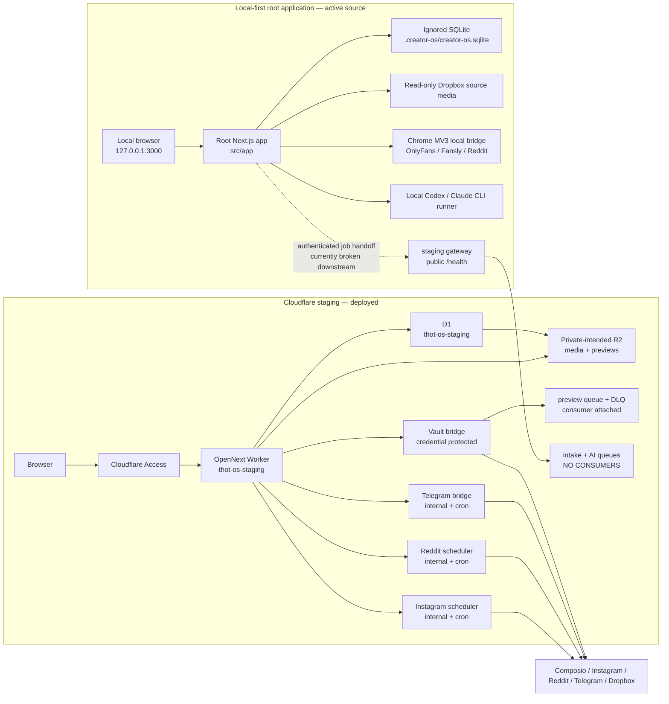
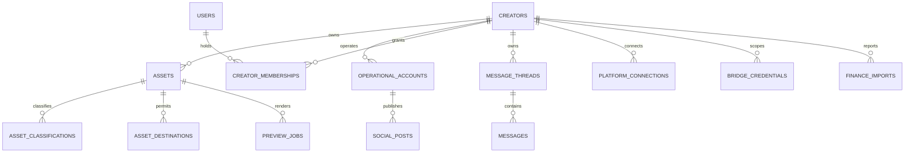

# THOT OS — Codebase, Infrastructure & Deployment Audit

**Audit date:** 2026-08-15 (Australia/Perth)
**Repository snapshot:** committed `main` at `d2043994c5e8f904f12403a676d6574199d07fc9`; separately assessed current dirty working tree
**Method:** read-only source/configuration review, safe Git inspection, local builds/tests/integrity checks, and authenticated read-only Cloudflare CLI/API inspection. No deployment, migration, data mutation, credential rotation, push, merge, delete, or configuration change was performed. Secret values are not included.

## Executive summary — where THOT OS is today

THOT OS is a real but split staging-era system, not one coherent deployable product yet.

- The **root application** is a capable local-first Next.js/SQLite operations tool. Its lint, build, and 32 tests pass. It contains the broadest feature set, including the only actual local AI-task runner and local Chrome bridge, but it has no user authentication and is only safe as a loopback/private tool.
- The **Cloudflare application** is a separately evolving OpenNext/D1/R2/Worker implementation. Its source-level Cloud suite (67 tests), build, D1 migration replay, and Worker type checks pass. Its staging app and four supporting Workers are genuinely deployed.
- The two paths are **not replicas or a staged schema upgrade**. Local SQLite (55 tables, 1,012 assets, 281 messages) and staging D1 (51 user tables, 403 assets, 328 messages) are active, divergent data authorities with different schemas and histories.
- Staging deployment is real but incomplete: OpenNext is behind Cloudflare Access; D1, four R2 buckets, and four queues exist. The preview queue works structurally. The intake/AI automation pipeline is **broken**: its two queues have no consumers, and its configured failure queue does not exist.
- There is no verified THOT OS production environment. Every deployable config and discovered resource is staging-named. A Cloudflare D1 service field called `production` is not a THOT OS production deployment.
- The repository cannot presently be treated as a reproducible source of truth. `main` is clean, but the working tree has 30 modified tracked files and 22 untracked files, including D1 migrations `0021`–`0027`, finance, Reddit, preview, Vault Bridge, extension, and test work. The ignored `.creator-os/` directory contains the only observed local database, backups, catalogue, and deployment receipts.

The immediate priority is preservation and source-of-truth decisions, not refactoring. Freeze destructive work, snapshot both databases, protect the dirty tree, declare the authority for each feature/data domain, and mark the queue automation unavailable until it is deliberately repaired and verified.

## Scope, confidence, and terminology

| Label | Meaning in this report |
|---|---|
| **VERIFIED** | Directly observed through source, a passing local command, or a read-only remote provider response. |
| **IMPLEMENTED / NOT VERIFIED** | Code/configuration exists, but no live end-to-end operation was proven. |
| **PARTIAL** | A meaningful slice exists but has an unimplemented, broken, or unverified critical step. |
| **STUB / PLACEHOLDER** | UI/documentation/config names the feature without an operative backend. |
| **PLANNED ONLY** | Discussed in documentation/TODOs but not implemented. |
| **BROKEN** | Source/configuration exists and evidence proves it cannot currently fulfil its declared flow. |

The Cloudflare inspection used authenticated read-only commands. It cannot rule out portal-only configuration that Wrangler does not expose, such as custom routes, WAF detail, or unrelated account resources. No test had an authenticated Cloudflare Access session, so protected application behavior is not claimed as live merely because the Worker is deployed.

## Current architecture

### Architecture interpretation

There are two product implementations with overlapping responsibilities:

| Path | Actual role today | Data authority | Key boundary |
|---|---|---|---|
| Root `src/**` | Local operational prototype with the richest breadth of features | Ignored SQLite | Loopback-only process; not end-user authenticated |
| `cloudflare/thot-os-next/**` | Staging Cloudflare-first application | D1 + R2 | Cloudflare Access JWT plus D1 user/membership/role checks |
| `cloudflare/thot-os-app/**` | Older/minimal Worker foundation | Same D1/R2 targets | **Shares the OpenNext Worker name; deployment collision** |
| `cloudflare/staging-gateway/**` | Intended local-to-Cloud queue/callback gateway | Queues | Currently stale and missing consumers |
| Four dedicated Workers | Platform adapter, scheduling, bridge, preview behavior | D1/R2 + provider APIs | Service bindings or scoped bearer/device credentials |

This is not necessarily accidental: the Cloud path was clearly built as a migration. It is unsafe to treat the local path as legacy or delete it because it still holds unique operational data and active features. It is equally unsafe to treat the Cloud path as an authoritative replacement until feature/data ownership is explicitly decided.

## Repository inventory

| Area | What exists | Status / note |
|---|---|---|
| Root web application | Next.js 16, React 19, TypeScript in `src/app`, `src/lib`, `src/components` | Local-first, verified build |
| Cloud web application | `cloudflare/thot-os-next`, Next.js/OpenNext Cloudflare | Staging-deployed |
| Legacy Cloud Worker app | `cloudflare/thot-os-app/src/index.ts` | Verify first; conflicts with Cloud app name |
| Workers | `instagram-scheduler`, `reddit-scheduler`, `telegram-bridge`, `vault-bridge`, `staging-gateway` | See deployment matrix |
| Root database | SQLite, `src/lib/db.ts`, ignored `.creator-os/creator-os.sqlite` | Active, unique, divergent |
| Cloud database | D1 migration set `0001`–`0027` | Active staging database |
| Object storage | Local Dropbox source index; Cloud R2 media/previews/intake/packages | Cloud buckets exist; public-access setting not independently visible |
| Queues/jobs | Root automation tables and in-process scheduler; Cloud queues and cron Workers | Preview pipeline attached; intake/AI pipeline broken |
| AI integrations | Local Codex CLI and Claude Code CLI runner | Local only, no model SDK/Workers AI integration |
| Browser automation | MV3 extension under `public/local-bridge-extension` | Assisted workflows, no browser E2E proof |
| CLI/scripts | npm scripts plus DB, index, export, preview, and Telegram migration scripts | Some scripts are explicitly mutating; not run |
| Tests | Root 9 test files; Cloud app 11; Telegram 1 | Source/unit/integration-oriented, no browser E2E or live provider tests |
| CI | `.github/workflows/verify.yml` | PR verification only; no deploy/promotion |
| MCP tooling | No project MCP server or tool implementation found | Planned only |
| Supabase/Vercel | No configuration, dependency, CLI evidence, or deploy evidence | Not in use |

## Deployment state

### Deployable component matrix

| Component | Local | Staging | Production | Provider / target | Last verified deployment | Current commit correlation |
|---|---|---|---|---|---|---|
| Root Next.js/SQLite app | Builds locally; binds `127.0.0.1:3000` | No separate deployment found | None | Local Mac | N/A | N/A |
| `cloudflare/thot-os-app` legacy Worker | Configured | **Do not deploy:** same name/history as OpenNext | None | Cloudflare Worker `thot-os-staging` | Same history as OpenNext | Unknown |
| OpenNext Cloud app | Builds/tests locally | **DEPLOYED**, 100% routed | None found | `https://thot-os-staging.thot-os.workers.dev` | 2026-08-15 07:16 UTC, version `17e9658f…` | Unknown; Cloudflare reports source unknown |
| Vault Bridge | Typecheck passes | **DEPLOYED** | None | `https://thot-os-vault-bridge-staging.thot-os.workers.dev` | 2026-08-15 06:45 UTC, `e84c9da5…` | Unknown |
| Reddit scheduler | Typecheck passes | **DEPLOYED**, service-bound/cron | None | No public Worker URL (`workers_dev:false`) | 2026-08-15 07:15 UTC, `c2b6e04c…` | Unknown |
| Instagram scheduler | Typecheck passes | **DEPLOYED**, service-bound/cron | None | No public Worker URL (`workers_dev:false`) | 2026-08-10 23:33 UTC, `98c89f76…` | Unknown; stale versus August 15 worktree |
| Telegram bridge | Typecheck + tests pass | **DEPLOYED**, service-bound/cron | None | No public Worker URL (`workers_dev:false`) | 2026-08-10 23:29 UTC, `6e5c1235…` | Unknown; stale versus current direction |
| Staging gateway | Source exists | **DEPLOYED BUT BROKEN/STALE** | None | `https://creator-os-staging-gateway.thot-os.workers.dev` | 2026-08-07 00:08 UTC, `7b804757…` | Proven older than checked-in behavior |

Remote probes established the following without credentials being exposed:

- OpenNext `/health` returns a Cloudflare Access redirect (HTTP 302). The external access gate exists; authenticated app health was not tested.
- Vault Bridge rejects unauthenticated requests (HTTP 401).
- Gateway `/health` returns HTTP 200, but its payload does not match current source.
- Scheduler public URL probes return HTTP 404, consistent with `workers_dev:false` and service-binding use.

### Deployment drift and blockers

1. **Worker-name collision — High.** `cloudflare/thot-os-app/wrangler.jsonc` and `cloudflare/thot-os-next/wrangler.jsonc` both use `name: "thot-os-staging"`. Deploying either directory overwrites the same live Worker. Remote OpenNext assets/service bindings show OpenNext currently owns it.
2. **No deployment provenance — High.** Deployments are manual; no GitHub deployment workflow, promotion mechanism, SHA metadata, or source/version association exists. Remote Workers report `Source: Unknown`; comparison to `d204399` or the dirty WIP is impossible.
3. **Gateway is stale — High.** Remote gateway exports only `fetch`, while source exports `fetch` and `queue`; remote health lacks source’s `callbackConfigured` field. It was deployed on August 7.
4. **Automation queues cannot process work — High.** The remote intake and AI queues both have one producer and **zero consumers**. `thot-os-failures-staging`, declared as a dead-letter queue, does not exist. Do not call this automation live.
5. **Production is absent — Medium.** There are no `production` environment blocks, THOT OS production URLs, production-named D1/R2/queue resources, or a production deployment workflow.

## Infrastructure inventory

| Cloudflare product | Remote state | Code/config relationship |
|---|---|---|
| Workers | Six named THOT OS Workers are deployed | Verified individually; account-wide unrelated Worker inventory unavailable in installed Wrangler |
| Cloudflare Access | Present before OpenNext app | Verified via unauthenticated 302; policy detail not enumerated |
| D1 | One active `thot-os-staging` database, 7.84 MB | All migrations `0001`–`0027` recorded and no pending remote migrations |
| R2 | Four buckets: media, previews, creator-intake, creator-packages | All configured bucket names exist; portal public-access settings not independently verified |
| Queues | Four queues exist | Preview + preview DLQ correct; intake/AI have no consumer; failure DLQ absent |
| Cron triggers | Instagram, Reddit, Telegram schedulers every minute | Configured and Worker deployments exist; provider outcomes unverified |
| KV | None | No binding/configuration |
| Durable Objects | No code/config binding | Account-wide portal-only inventory not established |
| Workflows | None | No code/configuration |
| Vectorize | No indexes | No code/configuration |
| Workers AI / AI Gateway | No bindings found | No implementation despite AI queue names |
| Browser Rendering | No binding | No implementation |
| Pages | None found | No Pages config |
| Tunnel | None found | Conflicts with the intended private-callback narrative |
| WAF, rate limiting, Turnstile | Not evidenced in repo/read-only CLI | Do not infer absence; inspect later with scoped read-only access |
| Supabase/Vercel | None | No configuration/dependencies/CLI deployment evidence |

### Queue attachment state

| Queue | Actual producer | Actual consumer | Expected result | Classification |
|---|---|---|---|---|
| `thot-os-intake-staging` | `creator-os-staging-gateway` | 0 | Gateway consumer | **BROKEN** |
| `thot-os-ai-jobs-staging` | `creator-os-staging-gateway` | 0 | Gateway consumer | **BROKEN** |
| `thot-os-preview-staging` | Vault Bridge | Vault Bridge | Vault consumes | VERIFIED attachment |
| `thot-os-preview-dlq-staging` | none | Vault Bridge | DLQ consumer | VERIFIED attachment |
| `thot-os-failures-staging` | absent | absent | Gateway DLQ | **MISSING** |

## Environment audit

Environment values were not printed. All Cloudflare configuration is hard-coded to staging; there are no named `dev`, `staging`, or `production` environment blocks.

| Environment / location | Variable groups / resource links | Evidence / risk |
|---|---|---|
| Root `.env.example` | `CREATOR_OS_*`, `COMPOSIO_*`, `META_*`, `GOOGLE_*`, `REDDIT_*`, `XQUIK_API_KEY`, gateway values | Good partial name inventory, but no complete Cloud Worker contract |
| Root `.env.local` (ignored) | Root token/OAuth/Composio and gateway names | Present and loaded by root build; duplicate `COMPOSIO_API_KEY` and gateway entries observed; values withheld |
| Cloud `.dev.vars.example` | `LOCAL_ACCESS_BYPASS`, `NEXTJS_ENV` | Insufficient to simulate complete Cloud app locally |
| OpenNext Wrangler config | `ACCESS_AUD`, `ACCESS_JWKS_URL`, `ACCESS_ALLOWED_EMAIL`, `APP_BASE_URL`, `VAULT_BRIDGE_BASE_URL`, `STAGING_QA_ENABLED`, `CATALOGUE_SYNC_TOKEN` | Staging-only; build warns `CATALOGUE_SYNC_TOKEN` missing locally |
| Vault Bridge | `CATALOGUE_SYNC_TOKEN`, `COMPOSIO_API_KEY`, Dropbox account ID | Remote names verified; credential values withheld |
| Instagram / Reddit / Telegram Workers | `COMPOSIO_API_KEY`, provider auth-config/account/user IDs | Remote secret names verified; values withheld |
| Gateway | `STAGING_GATEWAY_TOKEN` | Current remote lacks callback URL/token source expects for completion |

Notable issues:

- `cloudflare/staging-gateway/wrangler.jsonc` has no `account_id`; with multiple authenticated Cloudflare accounts, non-interactive deployment/status is ambiguous and fails without manual account selection.
- Root local work can call the staging gateway. Local development therefore can affect remote staging queues; this must be intentional and explicit.
- `STAGING_QA_ENABLED` is deployed as `"1"` for OpenNext. The QA mutation endpoints are source-protected, but must never be silently copied to a future production config.
- All deployed Worker observability logging/tracing has 100% trace head sampling. Review redaction and retention before processing more creator/fan content.
- Local-only names with no static source match (`COMPOSIO_GOOGLE_CALENDAR_AUTH_CONFIG_ID`, `COMPOSIO_GOOGLE_DRIVE_AUTH_CONFIG_ID`, `COMPOSIO_TEST_USER_ID`) are **VERIFY FIRST**, not delete candidates.

## Database state

### Simplified schema map

### Staging D1 — verified active

- Database: `thot-os-staging`, created 2026-08-09.
- Schema: 51 reported user tables plus Cloudflare internal `_cf_KV`.
- Migration state: `0001` through `0027` applied; `wrangler d1 migrations list --remote` reported no migration to apply.
- Integrity: `PRAGMA foreign_key_check` returned no violations; `PRAGMA quick_check` returned `ok`.
- Activity in the last 24 hours: 83,788 reads and 44,492 writes.
- Sample counts: 3 creators, 403 assets, 6 operational accounts, 22 social posts, 328 messages, 46 threads, 4 users, 6 memberships, 358 preview jobs, 13 vault jobs.

Core D1 domain groups are library/consent, operational accounts/posts/provider connections, messaging/attachments, creator identity/memberships/service credentials/audit events, finance imports/metrics, and vault/preview queue records.

### Local SQLite — verified active and divergent

- Source: ignored `.creator-os/creator-os.sqlite`; 1.87 MB; modified 2026-08-10 05:10 UTC.
- Integrity: `ok`; foreign keys enabled; 55 tables, 13 indexes, 0 triggers.
- Applied migrations: local `001_initial` through `036_automation_control_plane`.
- Sample counts: 3 creators, 1,012 assets, 15 accounts, 16 post packages, 3 publication jobs, 281 messages, 53 threads.
- Local `npm run db:check` and `npm run db:isolation` pass; the latter ran 34 cross-creator relational checks.

### Schema/data drift conclusion

The SQLite and D1 stores are **parallel data models**, not schema versions of one database. They use different table names, relationship shapes, migrations, row counts, and feature authorities. No bidirectional sync or shared migration history was found. Treat both as valuable sources until a domain-by-domain authority and reconciliation plan exists.

D1 does not offer RLS. Isolation is enforced by Cloudflare application code (`creatorPrepare`), creator predicates, foreign keys, membership/identity checks, service grants, and audit triggers. This is a sound pattern when consistently applied, but any Worker binding or raw query that omits a creator predicate has database-wide authority. It is not equivalent to database-enforced RLS.

Migrations `0001`, `0003`, `0013`, and `0014` contain Adelaide-specific seed/data mutation behavior. They replay correctly in tests, but a fresh environment is a seeded historical replay rather than generic schema bootstrap.

## Feature inventory

| Feature | State | Deployment state | Actual evidence |
|---|---|---|---|
| Creator management | IMPLEMENTED / NOT REMOTELY VERIFIED | Local + Cloud code | Root actions; Cloud creators/admin/membership UI |
| Creator profiles, memberships, roles | IMPLEMENTED / TEST-VERIFIED | Cloud staging deployed, not authenticated E2E verified | D1 `0018`–`0020`, Access + membership authorization tests |
| Creator memory/context | PARTIAL / LOCAL ONLY | Not Cloud live | SQLite voice profiles, research and caption history; no vector/retrieval architecture |
| Asset/content library | IMPLEMENTED / TEST-VERIFIED | Cloud code deployed | Root Dropbox index; Cloud D1/R2 library and protected previews |
| Uploads | PARTIAL | Preview pipeline staged | Root source is read-only; Cloud preview/vault queue exists; no general direct-upload flow proven |
| Tagging, safety, consent | IMPLEMENTED / TEST-VERIFIED | Cloud code deployed | Asset classification/destination/paid-consent flows and tests |
| Platform suitability | IMPLEMENTED / TEST-VERIFIED | Cloud code deployed | Destination and classification rules |
| Social account management | PARTIAL | Cloud code deployed | Root OAuth/Composio; Cloud concentrates on Instagram, Reddit, Fansly |
| Publishing | PARTIAL | Worker code deployed, provider operation unverified | Approved local jobs; Cloud Reddit/Instagram adapter code; no real post verification |
| Scheduling | PARTIAL | Cron Workers deployed | Local scheduler and Cloud scheduled handlers; executions/provider outcomes unverified |
| Engagement/replies | PARTIAL | Cloud worker paths deployed | Local bridge plus Cloud Instagram/Telegram/Fansly flows; no provider E2E |
| Analytics | PARTIAL | Local working source; Cloud WIP uncommitted | CSV/import and Instagram sync; no live full pipeline |
| Finance/revenue | PARTIAL / UNCOMMITTED | Not deployment-correlatable | Cloud money/finance files and `0024` are untracked WIP; local reporting exists |
| AI agents | PARTIAL / LOCAL ONLY | Not Cloud deployed | Codex/Claude CLI runner; no Cloud model gateway/Workers AI |
| AI chatter/replies | PARTIAL | Not proven live | Draft/message workflow; provider delivery approval-gated |
| Creator portal | IMPLEMENTED / TEST-VERIFIED | Cloud app deployed | Creator/viewer isolation tests, no agency switcher |
| Agency admin | IMPLEMENTED / TEST-VERIFIED | Cloud app deployed | `agency_admin` role; no separate super-admin model |
| Authentication | SPLIT | Cloud Access deployed | Root has no user auth; Cloud validates JWT + active D1 user |
| Permissions/isolation | IMPLEMENTED IN CLOUD; UNSAFE IN ROOT IF EXPOSED | Cloud code deployed | Membership/role guards versus root cookie selector |
| Payment/subscription processor | STUB / PLANNED ONLY | None | Finance imports only; no Stripe/payment SDK/integration |
| Notifications/reminders | PARTIAL | Local/Cloud code only | Telegram handoff and creator reminders; no generic notification service |
| Queues/background jobs | PARTIAL / BROKEN | Preview attachment good; intake/AI broken | Queue inventory above; root scheduler is in-process/non-durable |
| Browser automation | PARTIAL | Local extension only | Assisted Chrome extension; not browser E2E verified |
| APIs | PARTIAL | Root + Cloud routes | No API versioning/OpenAPI contract |
| CLI | IMPLEMENTED | Local operations tooling | npm/Node scripts; several are mutating and need runbooks |
| MCP | PLANNED ONLY | None | No project MCP server found |

## AI and agent architecture

The only actual LLM agent execution is local:

| Dimension | Actual implementation |
|---|---|
| Providers | Codex CLI and Claude Code CLI |
| Call site | `src/lib/agents/runtime.ts`, initiated from root actions |
| Prompt/data | SQLite `agent_tasks` prompt and creator-scoped task data |
| Prompt protection | Task text is wrapped as untrusted data |
| Runtime isolation | Fresh temporary workspace per run; minimal allowlisted process environment; cleanup in `finally` |
| Execution control | Plan/read-only default; execute requires explicit approval |
| Logging/error handling | SQLite task status/output/error recording |
| Retries/cost/rate limits | No central rate limit, cost accounting, token budget, retry policy, or structured trace store found |
| Memory isolation | Creator scoping exists in task/database layer; no reusable cross-creator memory service/vector store exists |

The root agent runner has positive safeguards, but it is not a coherent multi-tenant agent platform yet. Executable paths are hard-coded to one Mac; `AgentTaskRequest.workspace` is accepted but not used because every execution is intentionally an empty temporary workspace. Cloud AI queues name an intended future function but no Cloud model/provider integration exists. Do not describe shared model infrastructure, creator memory retrieval, or autonomous agent orchestration as live.

## Security findings

### Critical

No source-backed Critical application vulnerability was established.

### High

| Finding | Evidence | Impact | Required action |
|---|---|---|---|
| Root dashboard trusts `creator_os_active_creator` cookie as tenant authorization | `src/lib/current-creator.ts:8-12`; media route and sensitive root actions use it without authenticated membership | A caller reaching the root origin can select another creator and cross a creator boundary for media/operational actions | Keep root loopback-only; before any hosting/tunnel use authenticated sessions, membership lookup and central server-side authorization. Treat cookie as UI preference only. |
| Root production dependency findings | Root `npm audit --omit=dev`: 4 high findings through `nanoid`, `next`, `postcss`, and `sharp` | Dependency vulnerabilities require assessment before broad exposure | Plan a narrow patched-version update with regression tests; do not blindly perform a major upgrade. |
| Staging deployment collision | Two deploy directories share `thot-os-staging` Worker name | A routine deploy can overwrite the live application | Resolve ownership/name before the next deploy. |
| Broken automation pipeline | Remote intake/AI queues have no consumer; configured DLQ missing | Jobs can be accepted and never processed/recovered | Disable/label feature unavailable; repair only under a deliberate deployment plan. |

### Medium

| Finding | Evidence | Impact | Required action |
|---|---|---|---|
| Local bridge pairing credential exposed in third-party URL fragment | Root action redirects with `#creator_os_pair`; extension reads `location.hash`; redemption makes a one-year bearer credential | A script compromise/XSS in the platform page during pairing could capture a long-lived scoped capability | Use same-origin/direct extension pairing, make token one-use, rotate to an installation/profile-bound credential, restrict CORS. |
| No D1 RLS | D1 isolation relies on application predicates and triggers | A missed creator predicate can become cross-tenant access | Centralize data access, eliminate raw unscoped queries, retain/add isolation tests. |
| Staging boundary ambiguous | No named environments; root can reach staging; hard-coded resource values/scripts | Local actions can affect staging; production promotion risk | Make dev/staging/prod contracts and write protections explicit. |
| Broad Cloudflare developer OAuth permission | Read-only inspection showed a credential capable across many write-capable Cloudflare products | Large operational blast radius if developer credential/session is compromised | Move deploy automation to scoped service identities and document ownership. |
| Full trace sampling | Worker observability 100% sampled | Creator/fan data can be over-collected in logs/traces | Establish redaction/retention review before scale. |

### Low

| Finding | Evidence | Action |
|---|---|---|
| Portal-only Cloudflare controls not fully inventoryable | Installed Wrangler lacks full Worker/DO/WAF custom-route visibility | Later use scoped read-only dashboard/API inventory. |
| Root localhost and extension URLs hard-coded | Loopback URLs in root/extension code | Consolidate configuration after architecture decision. |

Positive controls verified: Cloud OpenNext validates Cloudflare Access JWT signature/audience/expiry and active D1 user status; creator memberships/roles are server-derived; Cloud Vault Bridge credentials are hashed, active/expiry checked and installation-bound; signed public-media links have HMAC/one-hour expiry; integration secrets use AES-256-GCM; automation token comparison is timing-safe. No plaintext committed secret was found by a non-value-exposing scan, though dedicated historical secret scanners were not installed.

The sealed source scan found one High and one Medium issue. Its scope was partial because portal-only controls and live authenticated third-party flows were intentionally not exercised.

## Dependency audit

| Package root | Result | Recommendation |
|---|---|---|
| Root | 4 high production audit findings: `nanoid`, Next chain, PostCSS, Sharp | **Security critical planning.** Identify exact patched compatible release and regression test. |
| `cloudflare/thot-os-next` | 0 production findings | Recommended normal maintenance; it already overrides newer PostCSS/Sharp versions. |
| Four dedicated Worker roots | 0 production findings each | Recommended normal maintenance. |

The project has six independently locked npm roots. Every Worker repeats Wrangler `4.120.0` and TypeScript `^5.9.3`; this increases dependency/CI surface. Consider workspaces or a shared package policy only after source-of-truth protection. Do not consolidate/upgrade just for neatness now.

## Code quality and technical debt

| Priority | Problem | Evidence | Proposed action | Risk |
|---|---|---|---|---|
| P0 | Dirty migration/product work not committed | 30 modified + 22 untracked files | Snapshot and make a deliberate WIP checkpoint after approval | Work loss / impossible drift analysis |
| P0 | Two active data/product authorities | Local SQLite and D1 counts/schema diverge | Define authority per domain and reconciliation plan | Data loss or overwrite |
| P1 | Local DB monolith | `src/lib/db.ts` ~3,915 lines combines schema, migrations, queries and business rules | Lock behavior/tests, then split behind a data-access boundary | High refactor regression risk |
| P1 | Oversized cross-domain files | Root/Cloud actions, Instagram and Vault workers are ~760–924 lines | Split only after interfaces and tests are stable | Authorization/integration regressions |
| P1 | Root in-process scheduling | `src/instrumentation.ts` starts scheduling in a Next process | Explicitly choose local-only or durable Cloud job ownership | Duplicate/lost jobs |
| P1 | Deployment provenance absent | Manual uploads, remote source unknown | Add immutable SHA/version metadata and promotion receipt | Wrong code deployed |
| P2 | Generated types committed | Five Worker declarations + Cloud env declaration ~14.7K lines each | Decide generate-in-CI vs commit policy; verify TypeScript dependency first | Build breakage / noisy diffs |
| P2 | Documentation drift | README/architecture conflict with deployed staging evidence | Replace after authority/automation decisions | Operators act on false state |
| P3 | Duplicate worker lockfiles | Independent identical dependency roots | Evaluate workspaces later | Unnecessary complexity |

## Dead, legacy, and generated-code assessment

| Candidate | Classification | Evidence / action before any deletion |
|---|---|---|
| `.creator-os/` DB, backups, catalogue, deployment receipts | **DO NOT TOUCH** | Unique local data/evidence; ignored by Git |
| `.creator-os/creator-os.db` zero-byte file | **VERIFY FIRST** | Unreferenced in reviewed source but do not delete before backup inventory |
| Root SQLite app | **DO NOT TOUCH** | Sole active local authority, bridge and agent capability |
| `cloudflare/thot-os-app` legacy worker | **VERIFY FIRST** | Name collision with live OpenNext Worker; resolve ownership first |
| `cloudflare/thot-os-next/src/app/reddit/page.tsx` legacy redirect | **SAFE after route validation** | Explicit redirect to Operations |
| Merged `codex/thot-os-phase1*` branches | **SAFE after confirming no worktree/process relies on them** | All six are merged into `main` locally/remotely |
| Tracked Wrangler generated declaration files | **VERIFY FIRST** | Generated but may presently be type/build contract |
| Ignored `.next`, `.open-next`, `.wrangler`, `output/` | **SAFE generated artefacts** | Properly ignored; keep no unique exports before cleaning |
| Local scheduled Reddit route | **VERIFY FIRST** | Intended Cloud replacement exists but local flow may still be operational |

## Git health

| Item | Finding |
|---|---|
| Branch | `main` at `d204399`, tracks `origin/main`, divergence 0/0 |
| Remote | One GitHub remote: `ThrillNoir/creator-os` |
| Branches | Six named `codex/thot-os-phase1*` branches exist locally/remotely; all are already merged |
| Working tree | 30 modified tracked files (`+1,349/-305`) and 22 untracked files at audit snapshot; `git diff --check` passes |
| Large tracked files | No individual tracked file above 1 MiB; generated Worker declarations are ~550 KB each |
| Git object health | Small repository; unreachable loose Git objects were found, another reason to preserve current work before pruning/GC |
| Ignored operational data | `.creator-os/` hides local DB, backups, catalogue and deployment receipts |
| Secret history scan | No obvious tracked plaintext credential assignment; `gitleaks`/`trufflehog` unavailable, so this is not a complete historical secret audit |
| Source-of-truth conclusion | **Not clean/reproducible yet.** Committed `main` is clean, but current operational changes and data are not safely represented by Git alone. |

## Testing and local reproducibility

### Checks run in this audit

| Check | Result |
|---|---|
| `npm run lint` | Pass |
| `npm test` | Pass — 32 root tests |
| `npm run build` | Pass |
| Root DB integrity/isolation | Pass — SQLite integrity and 34 isolation checks |
| `npm run verify:cloudflare` | Pass — Worker typechecks, Telegram 4 tests, Cloud app 67 tests, Cloud build/OpenNext build |
| Cloud local build environment | Build passed but warned required `CATALOGUE_SYNC_TOKEN` is missing locally |
| Cloud D1 migration replay/rollback tests | Passed in Cloud app suite |
| Live provider/OAuth/browser/queue E2E | Not present/not performed |

Critical-flow test gaps to establish before cleanup or promotion:

1. Authenticated staging smoke: Access-protected health, one allowed creator, one denied creator.
2. A D1 migration receipt test that compares expected schema/migration state remotely without mutation.
3. One queue/R2 preview flow plus a negative DLQ/consumer attachment check.
4. Extension regression that proves pairing is one-use/installation-bound after the security fix.
5. One provider sandbox/validation publish-and-receipt path per enabled integration.

### Fresh-machine reproducibility: low

A clone can install packages and compile, but cannot reproduce the operating system without historical state/manual setup.

- CI uses Node 22, but there is no `.nvmrc`, `.tool-versions`, or `engines` declaration.
- README says `npm install`, not a pinned `npm ci` workflow.
- Root needs ignored `.env.local`, Mac-specific Dropbox/media paths, Chrome extension loading, local Codex/Claude executable locations, external connections, and historical SQLite rows.
- The root DB is built/migrated in application code rather than a portable standalone migration/bootstrap workflow.
- Cloud build lacks a complete local environment sample and warns about missing `CATALOGUE_SYNC_TOKEN`.
- Mutating scripts (`migrate-telegram-cloud`, preview uploader, D1 export/import) are not clearly separated from generic setup.

## Documentation audit

| Document | Assessment |
|---|---|
| `README.md` | Partly accurate for local prototype; materially stale as system overview. It says Cloudflare resources are not connected despite deployed staging resources. |
| `docs/ARCHITECTURE.md` | Outdated direction: describes Cloudflare upload and remote database steps as future while D1/R2/Workers exist. |
| `docs/API-CONNECTIONS.md` | Useful root-local instructions; incomplete/outdated for Cloud Access and Cloud Reddit/Instagram work. |
| `docs/AUTOMATION-CONTROL-PLANE.md` | Accurately describes intended flow, but is not proof the pipeline works; remote evidence proves it does not currently. |
| `docs/AGENT-CONTROL.md` | Generally matches root runner; omits cost/rate/retry limitations. |
| `docs/phase-1l-production-readiness.md` | Most accurate boundary document: staging-only / production no-go. |
| Ignored deployment receipts/backups | Useful historical evidence, but cannot make a fresh clone reproducible. |

## Recommended cleanup and architecture improvements

Only improvements justified by verified findings are recommended:

1. **Declare one authority per domain before refactoring.** Create a short decision record for library/assets, accounts/identity, messages, approvals/publishing, analytics/finance, and agent memory. Each must say SQLite, D1, or a one-way reconciled migration; do not attempt generic sync.
2. **Make Cloud app ownership explicit.** Give the legacy Worker and OpenNext app distinct names before future deploys, or formally retire the legacy config only after snapshot/route confirmation.
3. **Move root isolation semantics to an authenticated boundary.** The Cloud membership model is the target pattern. Root must remain local-only until it can enforce a real identity-to-membership check.
4. **Consolidate data access only after authority is set.** Centralize Cloud D1 creator-scoped queries, preserve/expand cross-creator tests, and break root `db.ts` into schema/migration/repository modules only after behavior locks.
5. **Build a controlled deployment path.** Immutable Git SHA/version metadata, declared environment resource maps, scoped deploy identity, preflight migration/queue checks, authenticated smoke receipt, and rollback/snapshot runbook.
6. **Treat automation as disabled.** Fix it in a separate approved implementation/deployment change, not during cleanup.

## Recommended next development priorities

1. Protect and declare data/source authority.
2. Resolve deploy collision and broken queue pipeline, with a verified staging receipt.
3. Close root tenancy and bridge-credential security findings before any remote-root exposure.
4. Add minimal authenticated staging and queue/R2 regression tests.
5. Make the Cloud path reproducible (Node version, environment contracts, bootstrap, immutable deployment provenance).
6. Only then choose the highest-value feature slice—likely a verified creator-scoped content/preview and approval-to-publish vertical slice—rather than widening finance/AI/browser automation in parallel.

## Cleanup roadmap

### Phase 0 — Protect existing work

| Problem | Evidence | Proposed action | Risk | Priority |
|---|---|---|---|---|
| Uncommitted source can be lost | 30 modified + 22 untracked files, including migrations and Workers | Create checksummed snapshot and deliberate WIP branch/commit after review; do not overwrite local work | Critical work loss | P0 |
| Local DB/backups are unique | Ignored `.creator-os/` is sole observed local persistence/evidence | Copy/verify SQLite + WAL/SHM, backups, catalogue and receipts to an approved durable location | Irrecoverable data loss | P0 |
| Remote D1 is active and divergent | Recent high activity, different schema/counts | Obtain fresh non-destructive D1 export/snapshot and record manifest/checksums | Overwrite or mistaken reconciliation | P0 |
| Git has unreachable objects | `git fsck` found unreachable objects | Do not prune/GC until work is protected and object relevance checked | Lost unreferenced work | P0 |

### Phase 1 — Critical problems

| Problem | Evidence | Proposed action | Risk | Priority |
|---|---|---|---|---|
| Root tenant bypass if reachable | Cookie-derived creator scope, no root auth | Keep loopback/private; design authenticated membership guard before any hosting/tunnel exposure | Cross-creator data/action access | P0 |
| Long-lived bridge bearer exposure | Third-party URL fragment then year-long token | Redesign pairing capability (same-origin/direct extension, one-use, rotate/bind) | Private media/message capability theft | P0 |
| Automation silently fails | No intake/AI consumers, missing DLQ | Mark unavailable; repair/verify deployment in a dedicated change | Lost or stuck work | P0 |
| Shared Worker name | Legacy/OpenNext config collision | Freeze both deploy commands until names/ownership are resolved | Live app overwrite | P0 |
| Root dependency findings | 4 high audit findings | Plan/test a narrow compatible security update | Exposure grows with deployment | P1 |

### Phase 2 — Repository cleanup

| Problem | Evidence | Proposed action | Risk | Priority |
|---|---|---|---|---|
| Merged branches/noise | Six merged Phase 1 branches; generated declaration churn | After backups and CI proof, prune merged branches and decide generated-file policy | Accidentally removing useful contract | P2 |
| Ambiguous legacy paths | Root, legacy Worker, Cloud app overlap | Label each path/feature authority before deletion candidates | Destroying active capability | P1 |
| Stale docs/receipts outside Git | README conflicts; receipts ignored | Preserve receipts, then move durable runbook/evidence into versioned docs | Repeated operating mistakes | P2 |

### Phase 3 — Architecture cleanup

| Problem | Evidence | Proposed action | Risk | Priority |
|---|---|---|---|---|
| Parallel data authorities | SQLite vs D1 are incompatible and active | Implement only an approved domain-by-domain one-way reconciliation/cutover | Data corruption/loss | P1 |
| Monoliths/duplicated patterns | Huge DB/actions/workers | Extract authentication, repositories, provider adapters and job boundaries after tests exist | Behavioral regression | P2 |
| Non-durable local scheduler | Root process instrumentation | Decide explicitly local-only vs Cloud durable job owner | Duplicate/lost scheduling | P2 |

### Phase 4 — Testing & reliability

| Problem | Evidence | Proposed action | Risk | Priority |
|---|---|---|---|---|
| No deployed proof | CI is source/build only | Add authenticated staging smoke and version/SHA receipt | False deployment confidence | P1 |
| Queue pipeline untested/broken | Consumers absent remotely | Add non-mutating attachment check plus controlled queue/R2 integration test | Silent job loss | P1 |
| Provider/browser flow unproven | No E2E suite | Add minimum validation-mode provider and extension regression tests | Publishing/bridge regressions | P2 |

### Phase 5 — Documentation

| Problem | Evidence | Proposed action | Risk | Priority |
|---|---|---|---|---|
| Architecture docs are stale | Cloud implemented but documented as future | Update README, architecture, environment and deployment runbook from verified state | Unsafe operator assumptions | P2 |
| Fresh-machine setup incomplete | Mac paths/secrets/manual state | Document Node/CLI versions, environment name contract, bootstrap, backups and mutating-script warnings | Onboarding failure | P2 |

### Phase 6 — Resume feature development

| Problem | Evidence | Proposed action | Risk | Priority |
|---|---|---|---|---|
| Product breadth exceeds verified vertical slices | Many partial provider/AI/finance paths | Build one creator-scoped Cloud vertical slice: library/preview → classification → human approval → validation-only publish receipt | More unverified surface area | P1 |
| AI lacks operating controls | Local-only runner has no cost/rate/retry/trace policy | Add those controls only after tenancy/data authority is decided | Creator-context leakage/cost surprises | P2 |

## Bottom line

THOT OS has substantial verified implementation and an active staging footprint, but it is in a migration state with three release blockers: **unprotected/unauthenticated root tenancy if exposed, split SQLite/D1 authority, and broken Cloud automation/deployment provenance**. Preserve the work first, then resolve those blockers before cleanup or new feature expansion.
