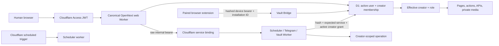

# THOT OS — Phase 1B Authentication, Authorisation & Tenant Isolation

**Status:** Local implementation and verification complete; not deployed.

**Scope:** Canonical Cloudflare OpenNext application (`cloudflare/thot-os-next`), its D1-backed identity model, supporting Cloudflare Workers, Vault/device bridge, and the retired local/gateway boundaries. This document records observed behaviour as of the Phase 1B local commit. It does not claim that a remote deployment has changed.

## Executive decision

THOT OS already has a sound browser-to-creator authorization chain in the canonical OpenNext application: Cloudflare Access proves the human identity, D1 proves that identity is active and has an active membership, and the requested creator is selected only from that membership set. A query parameter, selector cookie, form field, or payload does not grant creator access.

The material gap was internal Worker HTTP calls. Reddit Scheduler, Instagram Scheduler, Telegram Bridge, and the Vault catalogue route previously trusted Cloudflare service-binding reachability plus a caller-supplied `creatorId`. The Phase 1B local foundation now makes each receiving Worker verify a named, hashed D1 service credential and an active creator grant before it performs work. The raw bearer exists only in the canonical web Worker secret configuration; receiving Workers do not retain it.

No production environment exists, no remote D1/R2 resource was changed, no D1 migration was created or applied, and nothing was deployed. The current staging deployment therefore remains on its prior behaviour until an approved, credential-provisioned deployment occurs.

## Decisions made

| Decision | Result | Evidence and rationale |
|---|---|---|
| Canonical browser authority | **Cloudflare OpenNext + D1** | `access.ts`, `identity.ts`, and `authorization.ts` verify Access assertions, active users, memberships, and creator scope server-side. |
| Creator/workspace model | **A creator is the current authorization workspace** | Existing `creator_memberships` are explicit and creator scoped. No multiple-agency product requirement is implemented or proven. |
| Agency table now | **No** | Adding empty agency membership tables would not protect an existing path and could create misleading or broad future authority. Add only when agency-owned resources or multiple agencies are real. |
| True platform super-admin now | **No** | There is no platform-only administration surface and no safe bootstrap/dual-control process. `agency_admin` remains a creator membership, not a global role. Unknown `super_admin` labels fail closed. |
| Human roles | **Keep the four D1-constrained roles** | `agency_admin`, `operator`, `creator`, and `viewer` are the only membership roles. |
| Internal Worker calls | **D1 credential + per-creator grant** | The existing `service_credentials` and `service_creator_grants` model is now used by Worker receivers. |
| Cloud/browser bridge | **Retain existing device scope; do not expand it** | Browser credentials are hashed and bound to creator, account, profile, and installation ID. Hardening long-lived bearer replay is deferred to Phase 1C. |
| Local Node / SQLite | **Non-authoritative and loopback-only** | It must not use Cloudflare Access cookies as a substitute or be exposed as a tenant control plane. |
| Staging gateway | **Retired / do not repair** | It remains a known stale architecture and is not part of the Phase 1B service trust model. |

## Authority model

### Non-negotiable invariants

1. **Authentication is not authorization.** Access proves an email identity; D1 active-user and active-membership checks grant workspace access.
2. **Creator selection is UI state, not authority.** The `thot_os_creator` cookie can select only an already authorized membership and is ignored for creator/viewer portal identities.
3. **Every object read/write must bind the effective creator.** Private media binds the D1 object metadata to the effective creator before R2 access. `creatorPrepare` now rejects SQL that lacks the `@creator` boundary marker.
4. **A human role comes from D1, never a client field.** Browser-provided `actorRole`, `actor_role`, and `effectiveRole` values are rejected by the QA/audit boundary.
5. **A service principal never inherits a human session.** Receiver Workers validate their own named service credential and creator grant.
6. **Device credentials are independent of human sessions.** The bridge uses a creator/account/profile-bound token hash plus a registered extension installation ID.
7. **Unknown roles, missing membership, invalid credential, expired credential, or foreign creator scope fail closed.** Sensitive creator routes generally conceal unauthorized scope as `404`; internal Worker receiver authentication returns `401`.

## Actor and capability model

| Actor | Authentication proof | Authorization source | May not do |
|---|---|---|---|
| Human user | Verified Cloudflare Access RS256 JWT; active D1 `users` row | Active `creator_memberships` role for the effective creator | Choose arbitrary creator IDs, self-assert a role, use Access alone as workspace authority |
| `agency_admin` | Human proof above | Explicit membership for that creator | Act globally or across a creator without a matching membership |
| `operator` | Human proof above | Explicit membership | Manage identities, membership, bridge/profile administration |
| `creator` | Human proof above | Single creator portal membership | Select another workspace or use agency controls |
| `viewer` | Human proof above | Explicit membership | Mutate, approve, publish, or change identities |
| Internal service | Bearer hashed against `service_credentials` | Exact service name, active credential/expiry, active `service_creator_grants` row | Call another receiver type, act for an ungranted creator, claim a human role |
| Device bridge | Bearer hashed against `bridge_credentials` | Exact creator/account/profile assignment, active/non-expired credential, non-revoked profile, matching installation ID | Access a different creator, account, or profile |
| Scheduler cron | Cloudflare scheduled trigger | Worker-internal due/approval/creator predicates | Be exposed as a human or generic HTTP caller |
| Local Node (future) | Not currently trusted as a remote principal | Must use a future private, mutually authenticated job protocol | Receive browser authority or direct broad D1 access |

Current role permissions are intentionally coarse and must not be described as four-eyes approval:

| Role | `view` | `mutate` | `approve` | `manage_identity` |
|---|---:|---:|---:|---:|
| `agency_admin` | Yes | Yes | Yes | Yes |
| `operator` | Yes | Yes | Yes | No |
| `creator` | Yes | Yes | Yes | No |
| `viewer` | Yes | No | No | No |

`approve` currently does not enforce a different human from the author. If independent approval becomes a product rule, it needs a separate approval state transition and a D1-enforced self-approval policy rather than a label change.

## Browser route security matrix

| Surface | Entry proof | Effective scope | Capability | State |
|---|---|---|---|---|
| Pages and server actions | Access JWT + active D1 user | `requireCreatorContext` | Page/action-specific `view`, `mutate`, `approve`, or `manage_identity` | Verified |
| Creator selector | Access + membership | Exact `agency_admin` membership for selected creator | Administrative workspace selection | Verified; HttpOnly, SameSite=Lax cookie |
| Library API | Access + membership | Query value is resolved through `getCreatorContext` | `view` | Verified |
| Preview R2 route | Access + membership | D1 asset row matches effective creator and opaque object ID | `view` | Verified |
| Message attachment R2 route | Access + membership | D1 attachment row matches effective creator | `view` | Verified |
| Creator/account/profile administration | Access + membership | D1 account/profile rows include effective creator | `manage_identity` | Verified |
| Publish, scheduling, messages, analytics, finance | Access + membership | D1 writes/reads are creator-scoped | `mutate` or `approve` as implemented | Verified by source and regression coverage |
| OAuth completion callback | Access + membership | Context-derived creator passed to authenticated Worker | `manage_identity` | Hardened locally |
| Fansly pairing route | Access + membership | Pair issuer rechecks effective creator/account/profile | `manage_identity` and exact Origin | Hardened locally; missing Origin now denied |
| Staging QA human mutation | Access + membership + exact Origin + enabled staging flag | Requested creator is reauthorized | `mutate` | Staging-only source contract |
| Staging QA service mutation | D1 service credential/grant | Explicit requested creator | Service-only probe | Existing verified model |

## Internal service receiver matrix

The raw value named below is a **secret name only**. No secret value is stored in the repository, document, or receiver Worker.

| Caller | Receiver | Expected D1 `service_name` | Canonical web secret name | Required D1 grant | HTTP outcome without a valid grant |
|---|---|---|---|---|---|
| OpenNext | Instagram Scheduler | `thot-os-web-instagram` | `INTERNAL_INSTAGRAM_SCHEDULER_TOKEN` | One active row for the requested creator | `401` |
| OpenNext | Reddit Scheduler | `thot-os-web-reddit` | `INTERNAL_REDDIT_SCHEDULER_TOKEN` | One active row for the requested creator | `401` |
| OpenNext | Telegram Bridge | `thot-os-web-telegram` | `INTERNAL_TELEGRAM_BRIDGE_TOKEN` | One active row for the requested creator | `401` |
| OpenNext | Vault catalogue refresh | `thot-os-web-vault-catalogue` | `INTERNAL_VAULT_CATALOGUE_TOKEN` | One active row for the requested creator | `401` |

The sender helper is `cloudflare/thot-os-next/src/lib/internal-service.ts`. The receiver helper is `cloudflare/shared/service-auth.ts` and validates, in order:

1. A bounded Bearer value is present.
2. Its SHA-256 hash matches an active D1 `service_credentials` record.
3. The record has the receiver's exact expected `service_name`.
4. The credential is not expired.
5. Its `service_creator_grants` record is active for the requested creator.
6. An `identity_audit_events` record names the verified machine principal, route, and credential identifier before route work begins.

This replaces the Vault catalogue's old global receiver-side `CATALOGUE_SYNC_TOKEN` comparison. The Vault receiver no longer requires or stores that raw secret.

### Required deployment provisioning order

Do not deploy this local change until all items are prepared for **staging** and independently reviewed:

1. Generate four distinct high-entropy bearer values outside source control.
2. Store each raw value only as its named canonical-web Worker secret above.
3. Insert only its SHA-256 hash into `service_credentials`, with the exact matching `service_name`, active status, and a bounded expiry/rotation policy.
4. Insert explicit `service_creator_grants` rows only for creators that require the service.
5. Run authenticated staging checks for a granted creator and a denied foreign creator before enabling normal use.
6. Deploy the web Worker and its receivers as one reviewed compatibility release. Do not apply only the receivers first, because they will correctly reject old callers.

This requires no schema migration: both D1 tables were created in migrations 0018/0019. It does require a deliberate remote data/secret provisioning change, which was expressly not performed in Phase 1B.

## Database and tenancy findings

### Verified current model

- `users` contains active/suspended human identities.
- `creator_memberships` ties an email to exactly scoped creator roles.
- Existing triggers protect a `creator` identity from being active in multiple creator workspaces or a staff role.
- `browser_profiles`, `account_browser_profiles`, and `bridge_credentials` have creator-bound keys and foreign keys.
- `service_credentials` plus `service_creator_grants` provide the existing machine-principal model now reused for internal Worker calls.
- D1 does not provide row-level security. The application and worker query predicates are therefore the real tenant boundary and must remain centrally reviewed and tested.

### Schema decision

No agency/workspace, platform role, or global super-admin migration was added. Existing `agency_admin` is a creator-level role despite its label. A future multi-agency design should introduce agency-owned resources, agency memberships, platform-only roles, bootstrap rules, and immutable audit coverage together; it must not auto-convert current per-creator memberships into broad agency access.

## Findings and disposition

| Priority | Finding | Phase 1B disposition |
|---|---|---|
| High | Scheduler and Telegram HTTP routes relied on service-binding topology and caller-supplied `creatorId`. | **Locally remediated.** Each receiver now validates a named D1 service credential plus creator grant before dispatch. Reddit/Instagram generic HTTP `/run` routes are removed; cron remains the due-publish mechanism. |
| High | Vault catalogue refresh receiver accepted one global token for all creators. | **Locally remediated.** It now requires `thot-os-web-vault-catalogue` and an active creator grant. |
| Medium | Access JWKS cache was indefinite in a warm isolate. | **Locally remediated.** Cache is capped at five minutes and refreshes once on an unknown key ID. |
| Medium | Successful Dropbox catalogue actions created audit statements without executing them. | **Locally remediated.** Both statements now call `.run()`. |
| Medium | Pairing route allowed an absent Origin. | **Locally remediated.** Pairing now requires exact same-origin POST. |
| Medium | A future `creatorPrepare` call could omit a creator predicate without structural rejection. | **Locally remediated.** The helper requires `@creator`. Existing call sites passed regression tests. |
| Medium | Operational audit tables are not fully append-only and do not all prove current service/human scope at the D1 trigger layer. | **Open.** Do not add broad triggers until all deployed writers and historical compatibility paths are mapped. Phase 1C should add an additive, tested immutable audit contract. |
| Medium | Instagram media path uses a shared Dropbox connected-account configuration rather than a demonstrated per-creator connection lookup. | **Open; high risk before multiple active creators.** Replace with the per-creator connection pattern already used by Vault/Reddit before onboarding another creator. |
| Medium | Browser bridge token is a long-lived bearer in `chrome.storage.local`; installation ID is binding metadata, not cryptographic proof of possession. | **Open.** Implement one-time pairing exchange, short-lived renewal, proof of possession, and credential/installation/request identifiers in audit data. |
| Medium | Telegram manual refresh uses a shared provider cursor; a creator-authorized refresh can process the shared stream while returning only the requested creator result. | **Open.** Split all-creator cron polling from a safe per-creator refresh design before multi-creator use. |
| High if exposed | Root Next/SQLite application selects creator scope from a cookie and can serve local media without canonical authentication. | **Contained but open.** It must stay loopback-only, non-deployable, and non-authoritative. Never expose it as a remote or multi-tenant app. |
| High if reactivated | Staging gateway accepts shared static bearer callbacks without creator-granted identity. | **Contained but open.** It remains retired; future Local Node must use private mutual authentication, signed bounded jobs, and per-creator capability grants. |

## Residual security controls and limitations

- The current Cloudflare Access policy/hostname coverage was not changed in this phase. Re-verify live Access policy, custom hostnames, worker preview URLs, and staging application before deployment.
- Service credentials are scoped by receiver service name and creator grant, but not yet by finer action capability. Do not add new sensitive receiver routes under an existing service name without a capability design review.
- The new service auth code is **not active remotely**. Treat the existing staging Worker deployment as pre-Phase-1B until it is intentionally replaced.
- The local test suite proves code contracts and local D1 migration replay; it does not prove provider, Access, Cloudflare queue, or third-party OAuth runtime behaviour.
- No secret values, OAuth credentials, device bearer values, personal notes, or Dropbox media were read or written for this phase.

## Regression coverage added

`cloudflare/thot-os-next/tests/phase1b-security.test.mjs` verifies:

- Cross-creator denial for assets, message attachments, accounts, analytics, credentials, and publishing paths.
- URL, cookie, form, and payload creator-selection manipulation does not create authority.
- Role escalation attempts by viewer/operator and an unprovisioned `super_admin` label fail closed.
- Creator-scoped SQL requires the `@creator` boundary.
- Invalid, missing, and foreign-scope service credentials are denied before Worker work.
- Named service receivers use D1 service grants, while device bridge scope still requires the installation ID.
- JWKS key rotation, pairing same-origin enforcement, and previously missing Dropbox audit execution.

Existing canonical tests continue to cover creator portal isolation, QA human/service scope, D1 migration replay through 0027, profile/bridge constraints, private previews, attachment scope, and audit role contracts.

## Verification performed locally

| Check | Result |
|---|---|
| OpenNext TypeScript check | Pass |
| Instagram Scheduler TypeScript check | Pass |
| Reddit Scheduler TypeScript check | Pass |
| Telegram Bridge TypeScript check | Pass |
| Vault Bridge TypeScript check | Pass |
| OpenNext test suite | Pass (75 tests after Phase 1B additions) |
| D1 migration replay through 0027 | Pass as part of the OpenNext suite |
| Wrangler type generation for changed web/Vault config | Pass |
| `git diff --check` | To be rerun as part of final full verification |

## Phase 1C recommendation

Do not start cleanup/refactoring until the following release-preparation work is approved:

1. Provision and test the four staging service principals and grants, then perform a single reviewed staging deployment that updates both sender and receivers.
2. Replace Instagram's shared Dropbox connected-account path with creator-owned connections before onboarding a second active creator.
3. Make audit tables append-only and extend D1 provenance validation only after writer compatibility is fully mapped and tested.
4. Redesign the device bridge around one-time activation and proof of possession; shorten bearer lifetime and add targeted revocation/forensic audit fields.
5. Define the Local Node job-plane protocol before reactivating the gateway: private reachability, mutual service identity, timestamped signed jobs, strict schemas, per-creator capabilities, and immutable receipts.
6. Only then design real agency and platform-administration tables if product requirements demonstrate their need.

## Approval boundary

Phase 1B has made local source, configuration, tests, and documentation changes only. It has **not** deployed, pushed, applied a migration, inserted D1 credential/grant data, created an environment, changed Cloudflare Access, rotated a credential, changed R2, or repaired the gateway. Await explicit approval before any of those operations.
