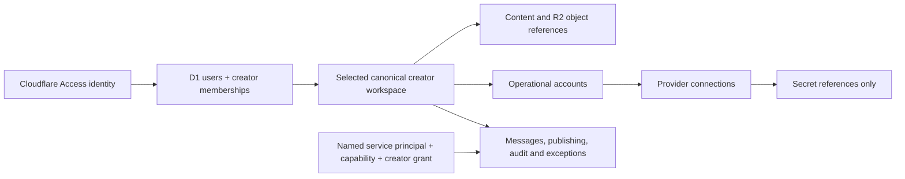

# THOT OS — Canonical Cloud Control Plane

## Status at the Phase 2A baseline

The intended canonical control plane is `cloudflare/thot-os-next`, backed by the staging D1 database `thot-os-staging` and canonical R2 media buckets. SQLite is a protected legacy archive and reconciliation source, not an operating authority. The root application is feature-frozen for canonical product work: permitted changes there are migration support, archive access, Local Node extraction, security containment, or retirement work.

This repository currently has the local Phase 2A implementation, but staging is **not verified**. The deployed Workers predate the Phase 1B internal-service contract, do not contain the four configured internal service secret bindings, and D1 currently contains no service credentials or creator grants. No current deployment metadata proves a repository SHA.

## Canonical workspace boundary

Every creator-owned operation must derive its creator from an active D1 membership or a validated service creator grant. URLs and the `thot_os_creator` cookie are only selection inputs; server-side authorization intersects them with active membership on every request. Creator and viewer portal identities have one workspace and never use the selector. Agency administrators and operators can select only their own active staff memberships.

## Onboarding

The canonical app provides an agency-admin-only metadata onboarding action. It creates only:

- a `creators` record;
- the authenticated administrator's active `agency_admin` membership;
- an immutable `creator_onboarding_receipts` record; and
- a creator-scoped identity audit event.

The workflow uses `creator-onboarding:<creator-id>` as its idempotency key and rejects differing retries, existing IDs/slugs, suspended operators, invalid identifiers, or invalid colours. It creates no accounts, provider connections, credentials, browser profiles, messages, automations, media, or historical SQLite data. A retry of the same request is safe; a different request with the same canonical creator ID is not silently accepted.

The planned Thrill Noir canonical ID is `thrill-noir`. Its workspace is not considered created until the gated staging operation has produced an onboarding receipt and a post-write isolation check. The 706 legacy assets, historical messages, tokens, bridge credentials, audit history, and automation remain excluded.

## Accounts, integrations, and exceptions

`operational_accounts` identifies a creator's platform account. `provider_connections` records the provider-side connection state. Secret material is outside both tables: it belongs in Cloudflare Secrets or a device secret store, while D1 stores only credential hashes/references and grants.

The control-plane overview derives a normalized status without rewriting legacy status values:

| State | Meaning |
| --- | --- |
| `CONNECTED` | Account is connected and, where applicable, provider state is active. |
| `NEEDS_RECONNECT` | Account/provider explicitly expired or requires reconnection. |
| `NOT_CONNECTED` | No authenticated account connection exists. |
| `ERROR` | A provider error or blocked account condition is present. |
| `DISABLED` | Reserved for an explicit disabled integration; never inferred from missing data. |
| `UNKNOWN` | Configuration is incomplete or cannot yet be verified. |

`creator_exceptions` mirrors the five still-open, reviewed Phase 1C.6 reconciliation exceptions for Adelaide and Bryshanagy. It never changes target-authoritative data. The evidence references the protected reconciliation report; the dashboard shows only the exception summary and remediation, never raw legacy data or secrets. Thrill Noir's former planning exception remains resolved only by a verified canonical onboarding receipt.

## Service principals

The intended current principals are named web-to-worker callers for Instagram scheduling, Reddit scheduling, Telegram bridge, and Vault catalogue work. Each credential must be independently provisioned, hashed before insertion into D1, explicitly granted to named creators, capability-scoped, auditable, revocable, and rotated without printing its secret.

The provisioning planner is local-only until an approved staging release. It validates an allowed service/capability/creator plan and emits a redacted receipt/command plan; it never reads or prints an existing Cloudflare secret. Staging secret provisioning is an operator approval gate because it creates credential material and must be coordinated atomically with sender and receiver Worker deployments.

## Health and staging verification

`/health` is protected by Cloudflare Access and a canonical creator membership. It reports only safe metadata: deployment component/environment/Git metadata, D1 connectivity and highest migration filename, selected-workspace asset/preview counts, and boolean critical-binding availability. It does not report a secret, credential reference, queue topology, or provider identity.

The staging status can be `VERIFIED` only when all of these are true:

1. deployment preflight passes for staging and rejects production;
2. the deployment receipt proves the deployed Git SHA and build time;
3. D1 migration state exactly matches the released migration set;
4. Access, membership filtering, creator switching, and cross-creator tampering checks pass;
5. the protected health endpoint passes with correct metadata and bindings;
6. four distinct service principals, their capability grants, and creator grants are provisioned and validated together; and
7. a protected smoke test and receipt succeed without provider posting.

## Gate A — local versus remote change plan

No remote mutation has been performed as part of this documentation update.

| Change | Local / remote | Data impact | Security impact | Reversible | Gate |
| --- | --- | --- | --- | --- | --- |
| Add canonical onboarding, exception visibility, normalized integration health, protected health contract, and tests | Local | Adds only code plus additive schema migrations | Improves authorization visibility; no secret material | Yes: un-deployed code can be reverted | Local tests, build, Cloud migration replay |
| Add D1 migration `0028` migration ledger | Remote staging | Additive audit tables only; no data migration | No credential access | Yes operationally: leave unused; do not drop | Fresh export, exact database identity, migration replay, release receipt |
| Add service capability migration and canonical-control-plane migration | Remote staging | Additive tables and five quarantined exception metadata records | Enables later least-privilege grants; no secret values | Yes operationally: leave unused; do not drop | `0028` first, reviewed SQL, fresh export, deployment release set |
| Deploy canonical OpenNext and four receiver Workers | Remote staging | Changes running code only | Replaces known old auth contract; must be atomic with principals | Roll back to prior Worker versions if smoke fails | Four principals/grants and their secrets are provisioned; deployment SHA receipt; protected health smoke |
| Provision four Cloudflare secrets and D1 credential hashes/capability grants | Remote staging | Inserts revocable D1 credential/grant metadata | Material secret creation; least privilege must be demonstrated | Yes: revoke D1 credential/grant and delete/replace secret under incident procedure | Explicit operator approval, single-use secret input, approved plan, no secret output, deploy set ready |
| Create `thrill-noir` workspace | Remote staging | One creator, one admin membership, one receipt, one audit event; no history | Expands access only for the authenticated agency administrator | Safely repeatable; status can be suspended, no deletion required | Migrations released, fresh backup/export, identity precheck, onboarding receipt, post-write isolation test |

At present the service-principal and deployment gates are not satisfied. Therefore the only permissible next remote action is preparation/review, not a forced deployment, secret provisioning, or creator write.

## Legacy boundary

The root SQLite application and `.creator-os` state remain protected archive/migration sources. They may not receive new canonical product features. Root-local browser automation, CLI execution and read-only source media work are future Local Node candidates; they must return creator-scoped receipts to D1 and never become a second operational database.
