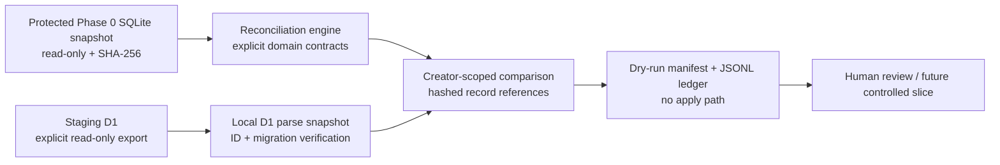
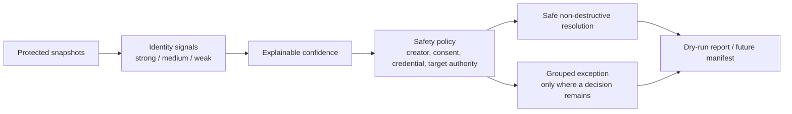

# THOT OS — Phase 1C.6 Automated Reconciliation & Exception Handling

**Status:** Read-only reconciliation, evidence-based resolution, exception grouping, and local-only migration-safety preparation complete. No creator data migration, remote D1 write, R2 upload, deployment, credential provisioning, or SQLite mutation was performed.

## Executive decision

SQLite and D1 are divergent systems with overlapping creator data, not replicas. Cloudflare D1 remains the canonical operational authority. The protected Phase 0 SQLite backup is a migration source/archive only.

Phase 1C.5 supplies a deterministic, creator-scoped comparator and dry-run planner. It has no apply implementation. Every automatic-looking action is still a proposal: `INSERT` is produced only for an explicit source-only record, while changed, sensitive, provider-bound, binary, financial, historical, and identity-dependent records are classified for human review or archive.



## Safety principles

1. **No generic copying.** The tool reads only the versioned domain contracts in `config/migration/domain-contracts.json`.
2. **No implicit source.** It requires absolute snapshot paths, rejects symlinks and live `.creator-os` paths, verifies SQLite integrity, and hashes the source before and after the run.
3. **No implicit target.** It accepts only `staging`, verifies the deployment registry and canonical Wrangler D1 name/ID/account, and requires a local parse snapshot whose migration state exactly matches the declared remote `0001`–`0027` baseline. This is historical Phase 1C.6 reconciliation evidence: it is not a generic bounded-release backup rule. Local `0028_migration_ledger.sql` was deliberately pending for that historical run and was not silently treated as deployed.
4. **No production path.** Any other environment, including production, fails before opening a database.
5. **No apply path.** `--apply` fails with `Migration apply is disabled by the Phase 1C.6 safety contract.`
6. **No secret migration.** OAuth material, API keys, refresh tokens, session cookies, and device/bridge bearers are excluded by contract.
7. **No binary migration.** Media reconciliation is metadata-only. An R2 key is evidence, not proof that an object may be overwritten or uploaded.

## Creator mapping

The versioned map is [creator-mappings.json](../config/migration/creator-mappings.json). It matches only exact stable ID plus slug and is limited to identity correspondence; it grants no record-level write authority.

| SQLite ID | D1 ID | Confidence | Evidence | Result |
|---|---|---:|---|---|
| `adelaide` | `adelaide` | High | Exact stable ID and slug in protected source and current D1 export | Reconcile only |
| `bryshanagy` | `bryshanagy` | High | Exact stable ID and slug in protected source and current D1 export | Reconcile only |
| `thrill-noir` | — | None | Source-only creator | Unmapped; no target creation inferred |
| — | `staging-authz-fixture` | High target-only | Current D1 fixture | Excluded; never match automatically |

Names, emails, handles, display labels, and provider identifiers are never enough to create a mapping.

## Domain migration matrix

| Domain | SQLite source | D1 target | Relationship | Future strategy | Risk / readiness |
|---|---|---|---|---|---|
| Creator profile | `creators` | `creators` | DIRECT | Exact mapped identity only; do not copy local media path | READY WITH REVIEW |
| Users / memberships | none | `users`, `creator_memberships` | TARGET ONLY | Keep Cloud authority | NOT READY for import |
| Assets | `assets` | `assets` | MERGE | Creator + relative path; protect D1 R2/Dropbox fields | READY WITH REVIEW |
| Classifications / destinations | matching tables | matching tables | DIRECT | Only after asset identity review | READY WITH REVIEW |
| Tags | `asset_tags` | none | TRANSFORM | Future creator-scoped target/archival representation | NOT READY |
| People / consent | `people`, links, attestations | matching core tables | TRANSFORM | Explicit person map; private notes and consent reviewed | NOT READY |
| Accounts | `accounts` | `operational_accounts` | TRANSFORM | Map platform/handle/label manually; preserve Cloud state | NOT READY |
| Provider / credential metadata | connection and Composio tables | provider connection tables | RETIRE / RECONNECT | Metadata review only; reconnect providers | NOT READY |
| Messages / threads / attachments | local messaging tables | canonical messaging tables | MERGE | Append-only after connection map; provider IDs only | NOT READY |
| Publishing / approvals | packages/jobs/events | `social_posts`, events | TRANSFORM | Historical receipt/archive design first | NOT READY |
| Scheduling / automation | reminders, events, workflow receipts | provider-specific run state | ARCHIVE ONLY | Do not reactivate jobs | ARCHIVE ONLY |
| Analytics | local Instagram analytics | Cloud snapshots/metrics | TRANSFORM | Source/import provenance and account map | NOT READY |
| Finance | local analytics/settings | D1 finance facts | TRANSFORM | Deterministic import identity and minor-unit conversion | NOT READY |
| AI / memory / research | voice, research, tasks | none | ARCHIVE ONLY | Privacy/retention and D1 schema design | ARCHIVE ONLY |
| Audit / history | local audit/event tables | Cloud audit tables | ARCHIVE ONLY | Never insert as current operational audit | ARCHIVE ONLY |
| Media bytes / previews | local source and asset metadata | R2 + D1 pointers | TRANSFORM | Separate metadata plan from future content-addressed upload | NOT READY |

## Dependency order

Use a **creator-by-creator, domain-by-domain** sequence:

1. Lock source snapshot, target D1 identity/migrations, and creator map.
2. Review creator and operational-account metadata; reconnect credentials separately.
3. Reconcile asset metadata, then classifications and destinations.
4. Create a person map before any people/consent links.
5. Map messaging connections, then threads, messages, and attachments append-only.
6. Preserve communities/post history as historical data; do not reactivate schedules or jobs.
7. Add analytics/finance only after deterministic import identities and currency rules exist.
8. Archive/re-design memory, AI history, automation, device state, credentials, and legacy audit events.

## Conflict semantics

| Classification | Meaning | Dry-run action |
|---|---|---|
| `SOURCE_ONLY` | Explicit source identity has no target equivalent | Proposed `INSERT`, still approval-gated |
| `TARGET_ONLY` | Cloud record has no source equivalent | `SKIP`; preserve D1 |
| `MATCH` | Domain-specific important fields agree | `SKIP` |
| `TARGET_AUTHORITATIVE` | Existing D1 record has protected metadata or a newer canonical D1 modification timestamp | `SKIP`; it may be inspected or have separately approved non-conflicting provenance attached, but is never overwritten |
| `CONFLICT` | Same identity with material field differences | `MANUAL_REVIEW` |
| `AMBIGUOUS` | No safe provider/connection/person identity | `MANUAL_REVIEW` |
| `ARCHIVE_ONLY` | Historical or noncanonical state | `ARCHIVE` |

Assets use creator-scoped relative paths and compare content metadata. D1 preview/R2/Dropbox metadata is protected. Messages and threads only match exact provider external IDs; a source-only provider ID remains ambiguous until its connection map is approved. Finance and analytics do not use timestamp-wins semantics. Credentials are always reconnect/secure-secret work, never a data copy.

## Phase 1C.5 reconciliation decisions

The machine-readable [connection mapping](../config/migration/connection-mappings.json) contains only one-way row references, classification, evidence labels, and credential treatment. It contains neither identifiers that would expose private account data nor credential material. It is evidence only: no entry grants write authority.

### Account and connection mapping

| Classification | Decision |
|---|---|
| **CONFIRMED** | Adelaide Fansly operational account, Adelaide Instagram provider connection, and Adelaide Telegram messaging connection have creator-scoped exact identity evidence. Existing target state remains authoritative. |
| **PROBABLE** | Adelaide Instagram operational account, Bryshanagy Fansly operational account, and Adelaide Fansly/Instagram messaging connections each have one plausible target but retain a material ambiguity. Human confirmation is required before a future scoped manifest can use them. |
| **UNMAPPED** | Target-only Adelaide MyRoomz/YouTube, source-only Bryshanagy Instagram/MyRoomz, unmapped YouTube/Dropbox/Reddit provider rows, and unmapped messaging connections remain outside any migration. |
| **CONFLICT** | Two Adelaide source Reddit accounts converge on one target candidate, and the Adelaide Reddit provider identity differs from the active target provider identity. The target connection is protected; no mapping or import is allowed. |
| **RETIRED** | Historical local bridge pairing artifacts and expired link requests are not credentials and are excluded permanently. Bryshanagy's unpaired/unseen OnlyFans local bridge is retired as migration input. |

Credential treatment is deliberately separate from identity correspondence:

- **Existing cloud credential:** retain the verified active target credential only; never copy source ciphertext, token hashes, sessions, or bridge material.
- **Reconnect required:** Bryshanagy Instagram/Dropbox/Reddit/Telegram if reintroduced, Adelaide Reddit after a human account choice, and source-only Adelaide YouTube/Dropbox require fresh authorization.
- **Retired:** all local bridge pairings and expired Composio/service link requests are historical artifacts.
- **Secure migration required:** none. No observed credential value qualifies for transfer.

### Thrill Noir decision

**Decision: `CREATE_CANONICAL_CREATOR` — owner-declared future Cloud authority.** Thrill Noir is an active THOT OS-managed brand and should eventually receive the canonical D1 creator/workspace `thrill-noir`. It is recorded in [creator-mappings.json](../config/migration/creator-mappings.json) as a **planning-only** future canonical mapping.

It does **not** create a remote creator, authorize child record migration, import credentials, or make SQLite history active Cloud state. The automated inventory now classifies 706 source-object-present assets plus dependent classifications as a future candidate set; 79 source-missing assets and 56 audit records as archive/review; accounts/connections/bridge/vault state as reconnect or excluded; and people, publishing, messages, and threads as manual review. A dedicated creator-creation phase and later source-object/consent/target comparison remain prerequisites.

### Target-authoritative and precedence rule

The reviewed precedence order is encoded in [safety-contract.json](../config/migration/safety-contract.json):

1. `TARGET_AUTHORITATIVE` — protected existing D1 state wins; no overwrite.
2. Canonical D1 newer metadata — classify target-authoritative when D1's modification evidence is newer.
3. `MATCH` — preserve without a write.
4. `SOURCE_ONLY` — a proposed `INSERT` only, still gated by an approved manifest.
5. `CONFLICT` / `AMBIGUOUS` — manual review; timestamps alone never establish write authority.

The repeated reconciliation now classifies Adelaide's **202** previously target-newer assets as `TARGET_AUTHORITATIVE`. It proposes **zero D1 `UPDATE` operations**. D1 R2, Dropbox, provider, audit, approval, and operational metadata are target-authoritative even where local metadata differs.

## Migration ledger and Phase 1D contract

`0028_migration_ledger.sql` is an additive **local-only** D1 migration. It has not been applied remotely. It intentionally does not reuse legacy `migration_runs`, which is written by an old `INSERT OR REPLACE` export script and is not append-only.

The new tables are:

| Table | Purpose | Safety property |
|---|---|---|
| `migration_ledger_runs` | Immutable approved-manifest/run provenance: creator, source/target checksums, target migration state, manifest, tool revision, approval reference, operator | Unique creator/source/manifest identity; staging-only check; updates/deletes abort |
| `migration_ledger_records` | Immutable per-source record result, source/target checksums, proposed operation, and result | Creator must equal its run; duplicate source record within a run is rejected; operation enum deliberately excludes `UPDATE`; updates/deletes abort |
| `migration_ledger_events` | Append-only lifecycle and verification events | Creator/run/record scope checks; updates/deletes abort |

The D1 database cannot authenticate a SQL caller by itself. The only allowed future writer is a dedicated migration executor using a scoped service identity after it verifies the reviewed manifest, creator, domain, snapshot checksums, target database ID/state, and operator/approval reference. Normal application routes, UI actions, Workers, and generic scripts must not write these tables.

### Phase 1D apply contract — deliberately disabled

There is no apply command. The kill switch is `applyEnabled: false` in the checked-in safety contract, and every current `--apply` invocation rejects before a database is opened. A future, separately approved executor must require all of the following before enabling one write:

1. Explicit `--environment staging`; production and any undeclared environment reject.
2. A fresh immutable protected source checksum and fresh read-only D1 export matching exactly the declared migration baseline.
3. A single creator and one explicit domain; no bulk `all` apply.
4. A reviewed manifest checksum and approval reference that exactly match the intended records.
5. Record-level ledger run, record, and event entries; source and target references must be creator-scoped.
6. An explicit `INSERT` or approved narrow operation. Broad or default `UPDATE` is denied; existing D1 records are not overwrite candidates.
7. Post-write duplicate, foreign-key, creator-isolation, R2-reference, and application-read verification, with a compensating/rollback plan for the specific record.

Failure of any gate must stop the run before the next record and write only a local failure receipt unless the future approved executor is authorized to append an in-D1 rejection event.

## Media and credential handling

The planner emits `R2_ALREADY_PRESENT`, `METADATA_ONLY`, `UPLOAD_REQUIRED`, or `SOURCE_MISSING` evidence within the media domain. Phase 1C does not list, upload, alter, or delete R2 objects. A D1 R2 pointer only produces metadata evidence; it is not an object-integrity assertion.

Connection metadata may be reviewed, but OAuth tokens, refresh tokens, API keys, session cookies, platform cookies, and long-lived bridge credentials are excluded. The expected future action is **RECONNECT** unless a separately approved secret-migration design exists.

## Tooling and workflow

```sh
# Explicit, local read-only export; writes only a local SQL + parse snapshot.
npm run migration:export-target -- \
  --environment staging --output /absolute/path/thot-os-staging.sql

# Compare an immutable SQLite snapshot with a D1 parse snapshot.
npm run migration:reconcile -- \
  --environment staging --creator all \
  --source-snapshot /absolute/path/source.sqlite \
  --target-snapshot /absolute/path/target.sql.sqlite

# Produce an auditable dry-run plan and file ledger.
npm run migration:plan -- \
  --environment staging --creator all \
  --source-snapshot /absolute/path/source.sqlite \
  --target-snapshot /absolute/path/target.sql.sqlite \
  --output /absolute/path/dry-run.json
```

Output always identifies `SOURCE`, `TARGET`, `MODE`, and creator scope. The manifest contains snapshot checksums, D1 ID/migration state, explicit creator mapping, hashed record references, classification counts, proposed operations, conflicts, exclusions, tool Git SHA, and timestamp. The JSONL ledger records manifest hashes and migration IDs. Neither contains raw records, credentials, private notes, or media bytes.

The Phase 1C committed dry run is [2026-08-15-phase1c-staging-dry-run.json](./migration-reports/2026-08-15-phase1c-staging-dry-run.json). Its raw D1 SQL export and parse snapshot remain outside the repository under the protected backup root.

## Real read-only reconciliation results

Source: protected Phase 0 consistent SQLite snapshot, SHA-256 `2f404975…f17c4c`, integrity `ok`.

Target: current staging `thot-os-staging`, registry ID verified, local read-only export parsed with migrations `0001`–`0027` exactly matching the canonical migration directory. No remote mutation occurred.

| Creator | Domains analysed | Source-only | Target-only | Matches | Conflicts / ambiguous | Archive-only |
|---|---:|---:|---:|---:|---:|---:|
| `adelaide` | 13 | 0 | 3,830 | 675 | 253 (`202` target-newer assets, `1` classification conflict, `19` message/thread ambiguity, `24` media review) | 62 |
| `bryshanagy` | 13 | 2 | 123 | 0 | 5 (`1` media plus `4` account reviews) | 7 |
| `thrill-noir` | 0 | — | — | — | Unmapped creator | — |
| `staging-authz-fixture` | 0 | — | Target-only fixture | — | Excluded | — |

Important domain evidence:

- **Adelaide assets:** 24 match; 202 have newer D1 modification metadata; 117 are D1-only. No automatic update is proposed.
- **Adelaide classifications/destinations:** 194 and 212 matches respectively; one material classification conflict and 51/155 target-only records are preserved.
- **Adelaide messages/threads:** 24 and 19 exact provider-ID matches; 18 messages and one thread need an approved connection map; 304 messages and 27 threads are target-only.
- **Bryshanagy:** one source-only asset and classification are candidates for a future reviewed insert; 60 assets are target-only. The source asset has no approved binary-media action.
- **No finance/memory records** were present in either mapped creator’s analysed source slice; their schemas/semantics remain not ready.

## Future D1 schema support — design only

Do not apply these in Phase 1C:

1. `migration_batches` and `migration_record_map` with source snapshot/key hashes, creator/domain, target identifiers, decisions, before-image references, operator, state, and unique source provenance.
2. Creator-scoped asset tags and person social-tag representation.
3. Multi-asset historical post/receipt provenance, separate from active publishing jobs.
4. A privacy-reviewed structured creator profile/research/memory model.
5. Historical-import archive tables distinct from live audit tables.
6. Asset source-object/checksum metadata where Dropbox revision/R2 identity is insufficient.

## Verification and rollback design

A future approved apply must capture a new D1 export, use a reviewed immutable source, record per-record provenance, verify counts/foreign keys/creator isolation/duplicate identities/R2 references/application reads, and retain before-images or compensating operations. Restoring the whole D1 database is not rollback for a controlled creator/domain migration.

### Phase 1C.5 verification performed

| Check | Result |
|---|---|
| Reconciliation fixtures | Pass: source-only, target-only, match, target-authoritative, conflict, provider-ID message matching, cross-creator isolation, source-missing media, credential exclusion, declared baseline, production rejection, idempotent manifest, disabled apply |
| Root verification | Pass: lint, 45 tests, SQLite integrity/isolation, root build |
| Cloud verification | Pass: all Worker checks, Telegram tests, 76 OpenNext tests, D1 migration replay through local `0028`, Cloud Next and OpenNext builds |
| Deployment preflight | Pass: all staging components, local registry/config only |
| Repeated reconciliation | Pass: protected Phase 0 SQLite compared with the existing local parse of the read-only staging export. Adelaide now has 202 `TARGET_AUTHORITATIVE` assets and zero proposed D1 `UPDATE`s. |
| Current D1 export | Pass: explicit read-only staging export, locally parsed and verified through remote baseline `0027` |
| Remote mutation | **NO** — the export metadata reported zero remote rows written; no D1/R2 change, migration, deployment, or provider change was run |

The Cloud build retains the expected local warning for missing internal-service secrets. No values were created or read; this remains a staging-release provisioning gate rather than a Phase 1C build failure.

## Phase 1D readiness

THOT OS is **not ready for Phase 1D controlled data migration**. The migration safety contract and local ledger are ready, but no data slice is approved. Exact blockers:

1. Human confirmation for every `PROBABLE` account/connection mapping and a decision for each Reddit conflict.
2. A manual canonical-creator and retention decision for `thrill-noir`.
3. Source-object identity proof for Bryshanagy's apparent source-only asset, which is likely a duplicate of one existing D1 asset and whose source file is not currently found.
4. Resolve the dependent Bryshanagy classification only after that asset decision; it has no notes/review state, but cannot be applied without the asset identity.
5. Resolve Adelaide's 202 target-authoritative assets and one classification conflict only if a future domain need requires it; they are protected and are not a first-migration target.
6. A separately approved implementation of the Phase 1D executor, with the safety contract still disabled until a reviewed manifest exists.

There is **no safe first migration candidate today**. The formerly smallest candidate—Bryshanagy's one asset metadata record plus classification—is blocked because the source media/object identity is unverified and a same-basename/bytes/extension D1 candidate with different modification metadata, Dropbox revision, and preview R2 key exists. It must exclude binary-media upload, credentials, accounts, and any D1 update even after the identity issue is resolved. Adelaide has no source-only asset and has materially newer Cloud state, so it is not a first apply candidate.

## Phase 1C.6 — automated reconciliation by exception

The automated resolver is deliberately an **evidence and policy engine**, not an import engine:



`scripts/migration/identity-resolver.mjs` classifies evidence as `DETERMINISTIC`, `HIGH_CONFIDENCE`, `PROBABLE`, `AMBIGUOUS`, `CONFLICT`, or `NO_MATCH`. Exact immutable provider/source/message/post IDs, content checksums, and verified source-object identities are strong; handles and path/size metadata are corroboration only; display names and textual similarity cannot resolve an identity. Signals are deduplicated by evidence family, so correlated facts cannot inflate confidence.

`scripts/migration/resolution-policy.mjs` separately decides whether a result may be used as a non-destructive reconciliation link and whether it is a future candidate. No confidence level can bypass creator isolation, target authority, credential exclusion, consent, dependency, transformation, or apply-kill-switch controls. `AUTO_ELIGIBLE` is planning terminology only while `applyEnabled` remains `false`.

### Automated investigation results

The latest [automated reconciliation report](./migration-reports/2026-08-15T132002Z-automated-reconciliation.json) used the protected Phase 0 SQLite snapshot and a fresh read-only staging D1 export. It records only hashes/reason codes—never account identifiers, credentials, media paths, messages, or private notes.

- Adelaide Fansly messaging is now **deterministically** mapped for read-only identity purposes: the resolver found independent exact provider-thread and provider-message ID overlap. This authorizes no message import and does not alter target messages.
- Adelaide Instagram account/messaging remains **probable**: account continuity cannot be proven through an immutable source-to-target identity.
- Bryshanagy Fansly remains unresolved because the target handle is not corroborated by an immutable provider identity.
- Adelaide Reddit remains a grouped **conflict**: two local accounts and a different provider identity cannot be guessed into the active target account.
- Bryshanagy's asset is `SOURCE_MISSING` and `POSSIBLE_DUPLICATE`: its stale SQLite availability flag was overruled by a read-only source-object existence check, and its same creator filename/size/extension D1 candidate has protected Dropbox/R2 metadata. It is `NOT_SAFE`.
- Adelaide's 202 `TARGET_AUTHORITATIVE` assets remain protected and continue to produce zero proposed `UPDATE`s.

### Exception and candidate contract

`npm run migration:automated-reconcile` writes a machine-readable JSON report and compact Markdown operator summary. Exceptions are grouped by creator/domain/entity/classification/reason, have a stable hash ID, capped hashed samples, an aggregate checksum, attempted read-only investigation, risk, and recommended action. Routine matches, protected target records, archived records, reconnect-only rows, and source-only no-target services do not become individual operator tasks.

Candidate discovery requires an exact mapped creator, proven `SOURCE_ONLY` identity, no target authority/conflict, no credential payload, satisfied consent/dependencies, verified source object where required, supported target transformation, and D1 schema support. Ranking is deterministic: risk, dependency count, verification complexity, affected count, creator, domain, record reference. The current report contains **no safe candidate**.

### Phase 1C.6 safety invariants

1. A resolver never downgrades `TARGET_AUTHORITATIVE` data.
2. Weak evidence alone never maps identity; cross-creator candidates are ignored and recorded as an isolation block.
3. Credentials, sessions, bridge material, and binary uploads remain excluded or reconnect-only.
4. Thrill Noir future authority cannot create a creator or child record in this phase.
5. The staging-only target baseline remains `0001`–`0027`; local ledger migration `0028` remains unapplied remotely.
6. `--apply` still fails before snapshots are opened, production still rejects, and no path emits a D1 `UPDATE` operation.
