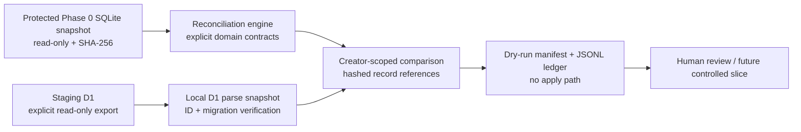

# THOT OS — Phase 1C Data Reconciliation & Migration Tooling

**Status:** Read-only reconciliation and dry-run planning complete. No data migration, D1 write, R2 upload, deployment, credential provisioning, or SQLite mutation was performed.

## Executive decision

SQLite and D1 are divergent systems with overlapping creator data, not replicas. Cloudflare D1 remains the canonical operational authority. The protected Phase 0 SQLite backup is a migration source/archive only.

Phase 1C therefore supplies a deterministic, creator-scoped comparator and dry-run planner. It has no apply implementation. Every automatic-looking action is still a proposal: `INSERT` is produced only for an explicit source-only record, while changed, sensitive, provider-bound, binary, financial, historical, and identity-dependent records are classified for human review or archive.



## Safety principles

1. **No generic copying.** The tool reads only the versioned domain contracts in `config/migration/domain-contracts.json`.
2. **No implicit source.** It requires absolute snapshot paths, rejects symlinks and live `.creator-os` paths, verifies SQLite integrity, and hashes the source before and after the run.
3. **No implicit target.** It accepts only `staging`, verifies the deployment registry and canonical Wrangler D1 name/ID/account, and requires a local parse snapshot whose migration state exactly matches `0001`–`0027`.
4. **No production path.** Any other environment, including production, fails before opening a database.
5. **No apply path.** `--apply` fails with `Migration apply is disabled during Phase 1C.`
6. **No secret migration.** OAuth material, API keys, refresh tokens, session cookies, and device/bridge bearers are excluded by contract.
7. **No binary migration.** Media reconciliation is metadata-only. An R2 key is evidence, not proof that an object may be overwritten or uploaded.

## Creator mapping

The versioned map is [creator-mappings.json](../config/migration/creator-mappings.json). It matches only exact stable ID plus slug and is limited to identity correspondence; it grants no record-level write authority.

| SQLite ID | D1 ID | Confidence | Evidence | Result |
|---|---|---:|---|---|
| `adelaide` | `adelaide` | High | Exact stable ID and slug in protected source and current D1 export | Reconcile only |
| `bryshanagy` | `bryshanagy` | High | Exact stable ID and slug in protected source and current D1 export | Reconcile only |
| `thrill-noir` | — | None | Source-only creator | Unmapped; no target creation inferred |
| — | `staging-authz-fixture` | High target-only | Current D1 fixture | Excluded; never match automatically |

Names, emails, handles, display labels, and provider identifiers are never enough to create a mapping.

## Domain migration matrix

| Domain | SQLite source | D1 target | Relationship | Future strategy | Risk / readiness |
|---|---|---|---|---|---|
| Creator profile | `creators` | `creators` | DIRECT | Exact mapped identity only; do not copy local media path | READY WITH REVIEW |
| Users / memberships | none | `users`, `creator_memberships` | TARGET ONLY | Keep Cloud authority | NOT READY for import |
| Assets | `assets` | `assets` | MERGE | Creator + relative path; protect D1 R2/Dropbox fields | READY WITH REVIEW |
| Classifications / destinations | matching tables | matching tables | DIRECT | Only after asset identity review | READY WITH REVIEW |
| Tags | `asset_tags` | none | TRANSFORM | Future creator-scoped target/archival representation | NOT READY |
| People / consent | `people`, links, attestations | matching core tables | TRANSFORM | Explicit person map; private notes and consent reviewed | NOT READY |
| Accounts | `accounts` | `operational_accounts` | TRANSFORM | Map platform/handle/label manually; preserve Cloud state | NOT READY |
| Provider / credential metadata | connection and Composio tables | provider connection tables | RETIRE / RECONNECT | Metadata review only; reconnect providers | NOT READY |
| Messages / threads / attachments | local messaging tables | canonical messaging tables | MERGE | Append-only after connection map; provider IDs only | NOT READY |
| Publishing / approvals | packages/jobs/events | `social_posts`, events | TRANSFORM | Historical receipt/archive design first | NOT READY |
| Scheduling / automation | reminders, events, workflow receipts | provider-specific run state | ARCHIVE ONLY | Do not reactivate jobs | ARCHIVE ONLY |
| Analytics | local Instagram analytics | Cloud snapshots/metrics | TRANSFORM | Source/import provenance and account map | NOT READY |
| Finance | local analytics/settings | D1 finance facts | TRANSFORM | Deterministic import identity and minor-unit conversion | NOT READY |
| AI / memory / research | voice, research, tasks | none | ARCHIVE ONLY | Privacy/retention and D1 schema design | ARCHIVE ONLY |
| Audit / history | local audit/event tables | Cloud audit tables | ARCHIVE ONLY | Never insert as current operational audit | ARCHIVE ONLY |
| Media bytes / previews | local source and asset metadata | R2 + D1 pointers | TRANSFORM | Separate metadata plan from future content-addressed upload | NOT READY |

## Dependency order

Use a **creator-by-creator, domain-by-domain** sequence:

1. Lock source snapshot, target D1 identity/migrations, and creator map.
2. Review creator and operational-account metadata; reconnect credentials separately.
3. Reconcile asset metadata, then classifications and destinations.
4. Create a person map before any people/consent links.
5. Map messaging connections, then threads, messages, and attachments append-only.
6. Preserve communities/post history as historical data; do not reactivate schedules or jobs.
7. Add analytics/finance only after deterministic import identities and currency rules exist.
8. Archive/re-design memory, AI history, automation, device state, credentials, and legacy audit events.

## Conflict semantics

| Classification | Meaning | Dry-run action |
|---|---|---|
| `SOURCE_ONLY` | Explicit source identity has no target equivalent | Proposed `INSERT`, still approval-gated |
| `TARGET_ONLY` | Cloud record has no source equivalent | `SKIP`; preserve D1 |
| `MATCH` | Domain-specific important fields agree | `SKIP` |
| `SOURCE_NEWER` / `TARGET_NEWER` | Asset source modification timestamp differs after identity match | `MANUAL_REVIEW`; timestamp is evidence, never write authority |
| `CONFLICT` | Same identity with material field differences | `MANUAL_REVIEW` |
| `AMBIGUOUS` | No safe provider/connection/person identity | `MANUAL_REVIEW` |
| `ARCHIVE_ONLY` | Historical or noncanonical state | `ARCHIVE` |

Assets use creator-scoped relative paths and compare content metadata. D1 preview/R2/Dropbox metadata is protected. Messages and threads only match exact provider external IDs; a source-only provider ID remains ambiguous until its connection map is approved. Finance and analytics do not use timestamp-wins semantics. Credentials are always reconnect/secure-secret work, never a data copy.

## Media and credential handling

The planner emits `R2_ALREADY_PRESENT`, `METADATA_ONLY`, `UPLOAD_REQUIRED`, or `SOURCE_MISSING` evidence within the media domain. Phase 1C does not list, upload, alter, or delete R2 objects. A D1 R2 pointer only produces metadata evidence; it is not an object-integrity assertion.

Connection metadata may be reviewed, but OAuth tokens, refresh tokens, API keys, session cookies, platform cookies, and long-lived bridge credentials are excluded. The expected future action is **RECONNECT** unless a separately approved secret-migration design exists.

## Tooling and workflow

```sh
# Explicit, local read-only export; writes only a local SQL + parse snapshot.
npm run migration:export-target -- \
  --environment staging --output /absolute/path/thot-os-staging.sql

# Compare an immutable SQLite snapshot with a D1 parse snapshot.
npm run migration:reconcile -- \
  --environment staging --creator all \
  --source-snapshot /absolute/path/source.sqlite \
  --target-snapshot /absolute/path/target.sql.sqlite

# Produce an auditable dry-run plan and file ledger.
npm run migration:plan -- \
  --environment staging --creator all \
  --source-snapshot /absolute/path/source.sqlite \
  --target-snapshot /absolute/path/target.sql.sqlite \
  --output /absolute/path/dry-run.json
```

Output always identifies `SOURCE`, `TARGET`, `MODE`, and creator scope. The manifest contains snapshot checksums, D1 ID/migration state, explicit creator mapping, hashed record references, classification counts, proposed operations, conflicts, exclusions, tool Git SHA, and timestamp. The JSONL ledger records manifest hashes and migration IDs. Neither contains raw records, credentials, private notes, or media bytes.

The Phase 1C committed dry run is [2026-08-15-phase1c-staging-dry-run.json](./migration-reports/2026-08-15-phase1c-staging-dry-run.json). Its raw D1 SQL export and parse snapshot remain outside the repository under the protected backup root.

## Real read-only reconciliation results

Source: protected Phase 0 consistent SQLite snapshot, SHA-256 `2f404975…f17c4c`, integrity `ok`.

Target: current staging `thot-os-staging`, registry ID verified, local read-only export parsed with migrations `0001`–`0027` exactly matching the canonical migration directory. No remote mutation occurred.

| Creator | Domains analysed | Source-only | Target-only | Matches | Conflicts / ambiguous | Archive-only |
|---|---:|---:|---:|---:|---:|---:|
| `adelaide` | 13 | 0 | 3,830 | 675 | 253 (`202` target-newer assets, `1` classification conflict, `19` message/thread ambiguity, `24` media review) | 62 |
| `bryshanagy` | 13 | 2 | 123 | 0 | 5 (`1` media plus `4` account reviews) | 7 |
| `thrill-noir` | 0 | — | — | — | Unmapped creator | — |
| `staging-authz-fixture` | 0 | — | Target-only fixture | — | Excluded | — |

Important domain evidence:

- **Adelaide assets:** 24 match; 202 have newer D1 modification metadata; 117 are D1-only. No automatic update is proposed.
- **Adelaide classifications/destinations:** 194 and 212 matches respectively; one material classification conflict and 51/155 target-only records are preserved.
- **Adelaide messages/threads:** 24 and 19 exact provider-ID matches; 18 messages and one thread need an approved connection map; 304 messages and 27 threads are target-only.
- **Bryshanagy:** one source-only asset and classification are candidates for a future reviewed insert; 60 assets are target-only. The source asset has no approved binary-media action.
- **No finance/memory records** were present in either mapped creator’s analysed source slice; their schemas/semantics remain not ready.

## Future D1 schema support — design only

Do not apply these in Phase 1C:

1. `migration_batches` and `migration_record_map` with source snapshot/key hashes, creator/domain, target identifiers, decisions, before-image references, operator, state, and unique source provenance.
2. Creator-scoped asset tags and person social-tag representation.
3. Multi-asset historical post/receipt provenance, separate from active publishing jobs.
4. A privacy-reviewed structured creator profile/research/memory model.
5. Historical-import archive tables distinct from live audit tables.
6. Asset source-object/checksum metadata where Dropbox revision/R2 identity is insufficient.

## Verification and rollback design

A future approved apply must capture a new D1 export, use a reviewed immutable source, record per-record provenance, verify counts/foreign keys/creator isolation/duplicate identities/R2 references/application reads, and retain before-images or compensating operations. Restoring the whole D1 database is not rollback for a controlled creator/domain migration.

### Phase 1C verification performed

| Check | Result |
|---|---|
| Reconciliation fixtures | Pass: source-only, target-only, match, conflict, provider-ID message matching, cross-creator isolation, source-missing media, credential exclusion, D1 mismatch, production rejection, idempotent manifest, disabled apply |
| Root verification | Pass: lint, 45 tests, SQLite integrity/isolation, root build |
| Cloud verification | Pass: all Worker checks, Telegram tests, 75 OpenNext tests, D1 migration replay through `0027`, Cloud Next and OpenNext builds |
| Deployment preflight | Pass: all staging components, local registry/config only |
| Current D1 export | Pass: explicit read-only staging export, locally parsed and verified through `0027` |
| Remote mutation | **NO** — the export metadata reported zero remote rows written; no D1/R2 change, migration, deployment, or provider change was run |

The Cloud build retains the expected local warning for missing internal-service secrets. No values were created or read; this remains a staging-release provisioning gate rather than a Phase 1C build failure.

## Phase 1D readiness

THOT OS is **not ready for Phase 1D controlled data migration**. Another reconciliation/design step is required first:

1. Approve a creator/account/connection mapping for messaging and provider identities.
2. Decide the target creator and retention policy for `thrill-noir`.
3. Add and test record-level migration ledger schema locally.
4. Resolve Adelaide’s 202 target-newer asset records and the classification conflict.
5. Design source-object checksum/R2 verification for the first media-backed slice.

The safest eventual first slice remains **Adelaide asset metadata plus classifications/destinations**, restricted to explicitly reviewed source-only records and never including binary media or a D1 update. No such migration has been performed.
