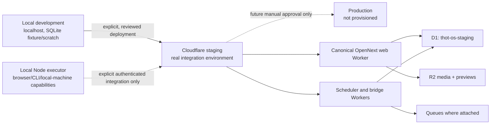
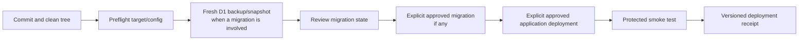

# THOT OS Deployment & Environment Architecture

Status: Phase 1A local safeguards completed on 2026-08-15. This document records the intended authority model and the verified staging inventory. It does not claim that a deployment, migration, queue, or publishing flow was run during this phase.

## Authority model



The canonical remote application is `cloudflare/thot-os-next`. Cloudflare D1 is the authoritative operational database, and Cloudflare R2 is the authoritative remote object store. Local Node remains an explicitly bounded executor for browser, CLI, and local-machine capabilities. The root Next/SQLite application is not a future remote control plane: SQLite remains a protected migration source, sanitised fixture, and non-authoritative Local Node scratch store.

The public creator-link surface is a separate, currently disabled Workers
Static Assets component. It receives only an approved KV projection and writes
aggregate click trends to Analytics Engine; it must never bind canonical D1,
private R2, Dropbox, provider credentials, or the Access-protected admin
application. Its paired private control Worker uses a Workflow to publish an
approved profile version. See [the rebuild cutover](THOT_OS_REBUILD_CUTOVER.md)
before provisioning either component.

`config/deployments.json` is the machine-readable source of truth for component ownership. It contains names and identifiers only; it must never contain credential values.

## Environments

| Environment | Authority and allowed resources | Deployment rule |
| --- | --- | --- |
| Local | Loopback development, local SQLite fixture/scratch, local mocks/test providers. Local code must not inherit Cloudflare staging credentials. | No Cloudflare deployment target. An action against staging requires an explicit environment argument and a reviewed runbook. |
| Staging | The one real Cloudflare integration environment. D1 `thot-os-staging`; four R2 buckets; four queues; the Workers below. | Explicit `--environment staging`, static preflight, clean Git tree for a plan/receipt, then separately approved manual deployment and smoke test. |
| Production | Naming/ownership contract only. No production Worker, D1, R2, queue, route, credential, or deployment exists. | Disabled in the registry. It cannot pass the preflight until separately provisioned and reviewed. |

The production naming contract uses `thot-os-<component>-production`, with separate D1, R2, and queue names ending in `-production`. It is deliberately not a copy of staging configuration: it has no account identifier or deployable components until production is formally created.

## Staging component ownership

The convention is `thot-os-<component>-<environment>`. Existing established names are retained when changing them would require a remote cutover. The canonical web Worker, `thot-os-staging`, is the documented compatibility exception; it is exclusively owned by the OpenNext application.

| Component | Local source / Wrangler configuration | Staging Worker | Staging resources | Status |
| --- | --- | --- | --- | --- |
| Web (canonical) | `cloudflare/thot-os-next/wrangler.jsonc` | `thot-os-staging` | D1 `thot-os-staging`; R2 `thot-os-media-staging`, `thot-os-previews-staging`; service bindings to itself and the four active Worker components | Deployable through guarded tooling |
| Instagram scheduler | `cloudflare/instagram-scheduler/wrangler.jsonc` | `thot-os-instagram-scheduler-staging` | D1 and `thot-os-previews-staging`; one-minute cron declared | Deployable through guarded tooling |
| Reddit scheduler | `cloudflare/reddit-scheduler/wrangler.jsonc` | `thot-os-reddit-scheduler-staging` | D1; one-minute cron declared | Deployable through guarded tooling |
| Telegram bridge | `cloudflare/telegram-bridge/wrangler.jsonc` | `thot-os-telegram-bridge-staging` | D1; one-minute cron declared | Deployable through guarded tooling |
| Vault bridge | `cloudflare/vault-bridge/wrangler.jsonc` | `thot-os-vault-bridge-staging` | D1, `thot-os-previews-staging`, preview queue and preview DLQ; consumer attachments declared | Deployable through guarded tooling |
| Legacy Worker | `cloudflare/thot-os-app/wrangler.jsonc` | `thot-os-legacy-staging` if ever explicitly approved | D1 plus media/previews R2 | Disabled; preserved for migration/reference |
| Legacy gateway | `cloudflare/staging-gateway/wrangler.jsonc` | `creator-os-staging-gateway` | Intake/package R2; intake/AI queues | Disabled; known stale/broken queue-callback architecture |

The legacy Worker configuration was changed **locally only** from `thot-os-staging` to `thot-os-legacy-staging`; it has also been marked non-deployable. This prevents normal repository deployment tooling from overwriting the canonical OpenNext Worker. It does not create, rename, or modify a remote Worker.

Retire the legacy Worker only after OpenNext has equivalent verified routes/data handling, a written migration/rollback record exists, no active invocation or service binding depends on it, and an approved archive decision has been made. Retire the gateway only after the Local Node job-plane replacement has verified callback authentication, durable handoff, and consumer ownership. Neither criterion is met today.

### Verified staging inventory

Read-only verification on 2026-08-15 found one staging D1 database, `thot-os-staging`; R2 buckets `thot-os-media-staging`, `thot-os-previews-staging`, `thot-os-creator-intake-staging`, and `thot-os-creator-packages-staging`; and queues `thot-os-intake-staging`, `thot-os-ai-jobs-staging`, `thot-os-preview-staging`, and `thot-os-preview-dlq-staging`.

The preview queue and DLQ have the vault bridge consumer. The intake and AI queues have a gateway producer but no consumer. The disabled gateway configuration refers to a failure queue that does not exist remotely. That broken legacy pipeline is intentionally not repaired or deployed in Phase 1A. Remote inventory remains a verification target—not proof of functionality.

## Guarded deployment model

### Service-auth release boundaries

The Phase 2A sequence is `EXPAND (0028–0031) → verify → COMPATIBILITY (0032)
→ verify → ACTIVATE → CUTOVER → CONTRACT`. The EXPAND release may stop safely
after `0031`: it does not alter the live `identity_audit_service_scope` trigger
or activate credentials. The compatibility migration is a distinct approval
because SQLite replaces triggers by drop/recreate. Activation and Worker
traffic changes require both prior boundaries; production remains disabled.

The EXPAND boundary must use the repository-owned bounded executor described
in [THOT_OS_BOUNDED_D1_MIGRATIONS.md](THOT_OS_BOUNDED_D1_MIGRATIONS.md), not
`wrangler d1 migrations apply`: normal Wrangler would also apply `0032`.

`npm run deploy` can no longer deploy ambiguously. With no arguments it fails. The only Phase 1A-supported form is a non-mutating plan:

```sh
npm run deploy -- --plan --environment staging --component web
```

The plan requires an explicit environment, exactly one component (or `--all`), and a clean Git working tree. It runs the static registry/Wrangler validation and prints the target, but it does not invoke Wrangler or make a remote change.

Use the preflight directly for repository/CI validation:

```sh
npm run deployment:preflight -- --environment staging --all
npm run deployment:preflight -- --environment staging --component vault --require-clean
```

The preflight fails closed when any of these differ from the registry: component Worker name, account, D1 binding/identifier/migration directory, R2 bindings, queue bindings, service bindings, or required secret **names**. It also rejects duplicate Worker ownership, unprovisioned/disabled environments, disabled components, missing configuration, ambiguous arguments, and resource names owned by a different environment. It validates only committed local configuration; it cannot prove that a secret exists remotely or that a remote binding has already been applied.

The two historic remote mutation scripts now also require `--environment staging --execute` before they can perform an R2 upload or remote D1 migration. That guard does not authorise their use: each remains subject to the runbooks and Phase approval below.

## Provenance and protected health metadata

The protected OpenNext `/health` route now returns a `deployment` object with only safe fields:

```json
{
  "component": "web",
  "environment": "staging",
  "gitSha": "<commit>",
  "gitBranch": "<branch>",
  "buildTime": "<ISO-8601 timestamp>"
}
```

The values are supplied at build time through `THOT_OS_COMPONENT`, `THOT_OS_ENVIRONMENT`, `THOT_OS_GIT_SHA`, `THOT_OS_GIT_BRANCH`, and `THOT_OS_BUILD_TIME`; absent values are visibly `unknown`/`local`, never inferred from credentials. The endpoint remains protected by the existing creator authentication boundary. The currently remote deployment predates this local change, so it is not yet expected to expose these fields.

## Controlled migration and deployment flow

Application deployment and D1 migration are separate operations. A future approved staging change follows this order:



Normal application deployment must not apply a migration. A migration requires a fresh export/snapshot, an explicit target and migration review, a checked migration state, and post-migration smoke testing. The current Phase 1A work does not apply migrations.

After an actually successful deployment, generate a durable, versioned receipt only from a clean tree and a passing preflight, for example:

```sh
npm run deployment:receipt -- \
  --environment staging --component web \
  --git-sha '<commit>' --git-branch '<branch>' --build-time '<ISO-8601>' \
  --worker-version '<Cloudflare-version-id>' \
  --migration-state '0001-0027 applied' \
  --smoke-status verified --operator '<operator-or-tool>' \
  --receipt docs/deployment-receipts/2026-08-15-staging-web.json
```

The receipt records component, environment, Git SHA, Git branch, build timestamp, Worker/version, receipt timestamp, migration state, static registry/config binding verification, smoke-test state, and operator/tool. `resourceBindingsVerified` means the registry and local configuration matched; remote verification must be stated in the smoke-test detail. Receipts never contain secret values.

## Smoke tests and rollback

“Deployed” means Cloudflare reports the expected Worker version after an approved deployment. “Verified” additionally requires an authenticated, protected smoke test that checks:

1. The expected Worker/version and Access protection are present.
2. `/health` returns the intended component/environment/Git SHA/build timestamp and D1 connectivity.
3. A creator-scoped request cannot read another creator's asset or data.
4. The required R2 binding can perform the appropriate non-destructive read/metadata check.
5. Declared service bindings point to the registered Workers.
6. Queue consumer/producer attachment and scheduled Worker presence match the registry/Worker configuration.

Provider publishing, AI execution, queue processing, and legacy gateway callbacks are not part of this minimum smoke test and must remain `not-verified` unless directly tested.

Rollback is a separately approved deployment of the previous known-good application version, followed by the same protected smoke test and a receipt. Do not use application rollback to reverse database schema/data changes; a migration rollback requires its own data recovery plan.

## CI/CD direction and credentials

The existing pull-request workflow now runs the static staging preflight with no Cloudflare credential. It remains read-only: it does not deploy, contact Cloudflare, or run a migration.

The next delivery pipeline should be: pull request verification → merge to a protected branch → explicit staging deployment approval → protected smoke test → receipt → explicit production approval. Production remains absent and manual until a separately reviewed provisioning phase creates isolated resources, a production registry entry, and an approval boundary.

Current interactive developer authentication is broader than a deploy identity should be. Before staging automation, create a scoped non-human deployment identity limited to this Cloudflare account and only the Workers, D1, R2, Queues, and read-only verification operations actually required. Keep production credentials distinct and available only in a manually approved production environment. Do not rotate current credentials as part of this phase.

## Remote changes still required

None are required to establish the local collision safeguard, registry, preflight, provenance design, receipt design, or CI validation. No remote resource was created, renamed, modified, deployed, or deleted in Phase 1A.

Before the next real staging deployment, an operator must perform the controlled flow above and confirm the live Worker inventory and Access policy immediately before deployment. A later dedicated phase must decide whether to provision the uniquely named legacy Worker (only if it is genuinely needed) or retire its source after exit criteria are met. Production requires a separate provisioning and security review; it must never reuse staging names, identifiers, queues, or credentials.
# Canonical service-auth activation

The service-auth activation plan is not a deployment. Before any Worker traffic
changes, run the staging-only plan described in
[THOT_OS_SERVICE_AUTH_CUTOVER.md](THOT_OS_SERVICE_AUTH_CUTOVER.md), apply only
reviewed additive migrations, and retain a fresh D1 backup receipt. Never use
`wrangler secret put` as an isolated activation action because it creates a
Worker version; stage secrets with the compatible Web release and record the
rollback state.
